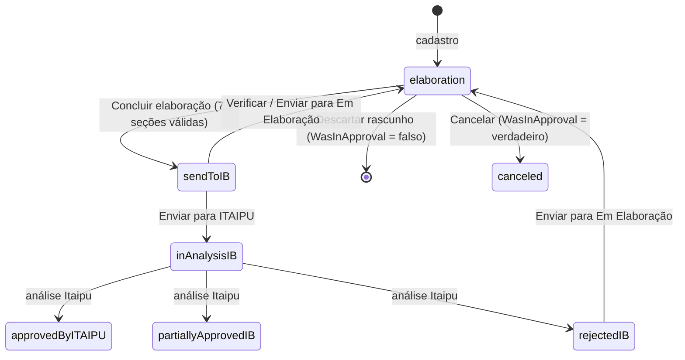

# O PMIB por dentro — o que o código do próprio portal ensina

> Levantado em **2026-10-13** (manifesto do portal em `versionSequence` **30465**) a
> partir do JavaScript que o PMIB entrega a qualquer navegador: o mesmo código que o
> Chrome baixa ao abrir a tela de login. **Nenhum login foi usado e nenhuma chamada
> que traz dados foi feita.** O código da Itaipu não está neste repositório, só o que
> se aprendeu com ele.
>
> **Para que serve.** [`PORTAL_COMO_ELE_SE_COMPORTA.md`](PORTAL_COMO_ELE_SE_COMPORTA.md)
> descreve o portal medido **na tela**. Este documento descreve o que está **por trás
> da tela**: o modelo de dados, as regras de validação, o ciclo de status e o protocolo
> entre a tela e o servidor. Leia a §0 antes de mexer em RPA. As recomendações para o
> SIG-FT estão na §8, e o resto é referência.
>
> **Legenda de confiança**, usada em todo o texto:
> - **[código]**: lido literalmente no código do portal.
> - **[inferido]**: dedução a partir do código.
> - **[a confirmar]**: só uma sessão logada responde.

---

## 0. O essencial em dez linhas

1. O PMIB é um app **OutSystems 11 Reactive**. O código das telas, as regras dos
   formulários e o modelo de dados vêm para o navegador em JavaScript legível, com os
   comentários que o OutSystems gera a partir do fluxo visual. **[código]**
2. Toda gravação é **um POST em JSON** que devolve uma resposta estruturada. Criar a
   ficha devolve o código PMIB. Gravar uma aplicação LMR devolve o Id dela. Gravar as
   características técnicas devolve, **linha a linha**, o que o servidor recusou.
   **[código]**
3. O SIG-FT hoje lê **só o DOM**: espera mensagem, conta nós e dorme. Ler a resposta que
   a tela já recebe resolve a "recusa silenciosa" da regra 6 sem nenhuma chamada nova
   (§8, R1).
4. As regras de validação de cada formulário estão no código. Por exemplo, o texto curto
   tem 40 caracteres, começa por letra e não aceita acento. O SIG-FT pode **recusar
   antes do portal recusar** (§5, R2).
5. Cada campo tem um **nome interno estável** (`Input_ShortText`, `TextArea_DiscardTypeES`
   etc.), sufixo do `id` no HTML. O prefixo `b10-b17-` muda conforme a tela, mas o
   sufixo não (§8, R3).
6. A ficha abre por **link direto**: `PMIB_DatasheetEdit?PMIB_DatasheetId=<Id>`. Assim não
   é preciso passar por pesquisa, sete abas e lápis. O Id vem da própria lista (§3, R4).
7. O manifesto `moduleservices/moduleinfo` é **público** e traz o hash de versão de cada
   tela. Dá para saber **qual** tela a Itaipu mudou antes de rodar o RPA (Apêndice E, R5).
8. O ciclo de status tem sete estados e regras claras para cada ação. A ficha aprovada
   passa a mostrar o código SAP e a solicitação de codificação do SAM GM, ou seja, o
   portal sabe se a ficha tem autorização (§4, R6).
9. "Concluir elaboração" exige **sete** seções válidas, calculadas no servidor.
   Transporte, manutenção e LMR **não** entram nessa conta. **[código]**
10. Chamar os endpoints direto, sem a tela, é tecnicamente possível, mas é uma decisão
    da Itaipu e da TI, não do SIG-FT. A §8 (R9) explica por que nem para leitura
    convém começar por aí.

**Cobertura.** Os **558 elementos interativos** das telas foram ligados, cada um, à ação
que disparam e ao efeito final (Apêndice F). Das **72 ações de servidor** do PMIB, 64 têm
caminho a partir de um clique ou da abertura da tela. As 8 restantes são utilitários
internos. O que o código cliente **não** pode mostrar está na §9.

---

## 1. Do que o PMIB é feito

| | |
|---|---|
| Plataforma | OutSystems 11, app **Reactive**, `OutSystemsUI` 2.18.2, ambiente `Production` **[código]** |
| App / módulo de entrada | `PMIB` / `PMIB` (provedor de usuários: `PMIB_Security`) **[código]** |
| Login | IdP unificado da Itaipu (`User_GetUnifiedLoginUrl`; usuários no **Keycloak**, pela ação `UpdateUserEnable_Keycloack`) **[código]** |
| Papéis | `PMIB_Provider` (fornecedor) e `PMIB_ProviderAdmin` (administra os usuários do fornecedor). Toda tela exige um deles **[código]** |
| Ecossistema | O PMIB é a porta do fornecedor para o **SAM**, a gestão de materiais da Itaipu. Os módulos `SAMGM_*` (GM = gestão de materiais) recebem a ficha aprovada **[código]** |
| Auditoria | Os módulos `AuditItaipuCore` e `AuditItaipuReact` são referenciados. Ações no portal provavelmente são registradas **[inferido]** |

Os módulos que importam para o SIG-FT:

| Módulo | O que tem | Scripts |
|---|---|---|
| `PMIB` | as 14 telas (lista, cadastro, edição, visualização, árvore de PDM, documentos, usuários) | 36 |
| `PMIB_DataSheet_CW` | **os blocos da ficha**: formulários, condições, LMR, características técnicas, popover de status | 71 |
| `PMIB_DataSheet_CS` / `_BL` | entidades da ficha e a validação das seções obrigatórias | 4 |
| `PMIB_Document_CW` / `_CS` | biblioteca de documentos do fornecedor | 18 |
| `PMIB_ProviderUser_CW` / `_CS` | usuários e contratos do fornecedor | 12 |
| `PMIB_Commons_CW`, `SAMGM_Commons_CW` | utilidades: popups de confirmação, validação de texto, classe de material | 21 |

As telas de ficha também rodam `CheckDatasheetProviderCreator` ao abrir. Se a ficha
não é "do criador", a tela redireciona para `InvalidPermissions` **[código]**. O
"criador" deve ser a empresa fornecedora, e não a pessoa **[inferido]**: a equipe edita
fichas criadas por colegas.

---

## 2. Como a tela conversa com o servidor

**É uma SPA de verdade.** Todas as URLs `/PMIB/<Tela>` apontam para o mesmo
`index.html` (`urlMappings` do manifesto) **[código]**. Esse é o motivo de fundo da
regra 1 do `PORTAL_COMO_ELE_SE_COMPORTA.md` ("a URL não diz nada").

**Cada leitura ou gravação é um `POST` JSON** em
`/PMIB/screenservices/<Módulo>/<Fluxo>/<Bloco>/<Nome>` **[código]**:

| Tipo (prefixo do nome) | Corpo enviado | Quantos |
|---|---|---|
| `Action…` / `ServiceAPI…`: grava ou comanda | `{"versionInfo": {"moduleVersion": <token do manifesto>, "apiVersion": <token da chamada>}, "viewName": "<Fluxo>.<Tela>", "inputParameters": {…}}` | 106 |
| `ScreenDataSet…`: consulta | o mesmo, com `screenData.variables` (**as variáveis da tela inteira**) no lugar de parâmetros. O servidor filtra | 152 |
| `DataAction…`: ação de dados | igual à consulta | 24 |

- **Cabeçalho `X-CSRFToken`**: é o valor `crf=` do cookie de sessão do usuário, que se
  chama `nr2` + nome do provedor de usuários. Sem o cookie, o cliente manda um token
  anônimo fixo. O mecanismo é **[código]**. O nome exato do cookie, provavelmente
  `nr2PMIB_Security`, está **[a confirmar]**.
- **Resposta**: `{"versionInfo": {"hasModuleVersionChanged", "hasApiVersionChanged", …},
  "data": {…}}` ou `{"exception": {…}}` **[código]**.
- **O `apiVersion` de cada chamada muda a cada publicação** do módulo pela Itaipu
  **[código]**: é o terceiro argumento de `callServerAction`. Quem chamar os endpoints
  "por fora" precisa reler esses tokens a cada deploy. Ler a resposta que a própria
  tela recebeu não tem esse problema (R1).
- **`/PMIB/moduleservices/moduleinfo` é público**: lista os 504 recursos do app, cada
  um com o hash da versão **[código]**. É a base do sentinela da R5.

O catálogo completo dos endpoints, com entradas e saídas, está no **Apêndice A**.

---

## 3. Telas, links diretos e o código PMIB

| Tela | URL | Parâmetro de entrada | Observação |
|---|---|---|---|
| Lista de fichas | `/PMIB/PMIB_DatasheetList` | — | sete abas por status (§4) |
| Ver ficha | `/PMIB/PMIB_DataSheetView?PMIB_DataSheetId=<Id>` | `PMIB_DataSheetId` (Long) | **o próprio portal monta este link** nos avisos de sucesso **[código]** |
| Editar ficha | `/PMIB/PMIB_DatasheetEdit?PMIB_DatasheetId=<Id>` | `PMIB_DatasheetId` (Long) | sem Id, redireciona para o cadastro **[código]** |
| Nova ficha | `/PMIB/PMIB_DatasheetCadastre?MDSId=<Id do PDM>` | `MDSId` (Long) | já abre com o PDM escolhido: nome ES/PT = básico + modificador do PDM **[código]** |
| Árvore de PDM | `/PMIB/PMIB_MDSTreeList` | — | grupos → classes → PDM |
| Documentos | `/PMIB/PMIB_DocumentsList`, `PMIB_DocumentView?DocumentID=`, `PMIB_DocumentEdit?PMIB_DocumentId=&IsFromConsult=` | | biblioteca de documentos do fornecedor |
| Usuários | `ProviderUser_List`, `ProviderUser_Form?ProviderId=`, `ProviderUser_View?ProviderId=&ProviderUserId=`, `SearchUser` | | só `PMIB_ProviderAdmin` |
| Outras | `Home`, `Contrato`, `InvalidPermissions` | | |

**O `Id` não é o código PMIB.** O código que a equipe usa, `4500063671.0071`, é montado na
tela como `DSNumber + "." + DSNumberSec` com quatro dígitos **[código]**. O `DSNumber` é
o número do contrato: o cadastro começa com `4500000000` e troca pelo contrato escolhido.
O `DSNumberSec` é o sequencial. O `Id` é a chave interna, e a lista entrega os dois
juntos. Cada linha de `GetPMIBDataSheetsByCreateBy` traz:
`Id, DatasheetCode, MDSCode, NameES, NamePT, ProjectCode, DSNumber, DSNumberSec, UpdateOn, WasInApproval`
**[código]**.

**A tela de edição** (`PMIB_DataSheet_DetailForm`) tem seis abas, e "Condições" tem
cinco subabas **[código]**:

```
Informações gerais | Fabricantes e fornecedores | Características técnicas |
Documentos e imagens | Condições | Aplicação - LMR
   Condições → armazenamento | transporte e movimentação | manutenção | financeiras | descarte
```

**Filtros da lista** **[código]**:
- `InputDatasheetFilter`: código, nome ES/PT, projeto ou contrato; máximo de 50 caracteres.
- `InputManufacturerFilter`.
- `InputContractFilter`.
- `InputMDSCode`: código do PDM.

Os filtros ficam em **variáveis de cliente** (`DatasheetFilterName`, `FilterManufacturer`,
`ContractNumber`, `MDSCode`) **[código]**. Por isso sobrevivem à navegação **[inferido]**:
um filtro esquecido da execução anterior pode esconder a ficha. Limpe todos antes de
pesquisar.

---

## 4. O ciclo de vida da ficha

| Status interno (`pMIB_StatusDatasheet`) | Aba na lista (PT) | O fornecedor pode | Endpoint |
|---|---|---|---|
| `elaboration` | Em Elaboração | editar; **concluir elaboração**; descartar o rascunho (se nunca foi à aprovação); cancelar (se já foi) | `ActionPMIB_ConcludeDatasheet`, `ActionPMIB_DataSheet_Discard`, `ActionPMIB_CancelDatasheet` |
| `sendToIB` | Para enviar à ITAIPU | editar; **enviar para ITAIPU**; "Verificar" ou "Enviar para Em Elaboração" (volta) | `ActionPMIB_SendToITAIPU`, `ActionChangeStatusDataSheet(…, elaboration)`, `ActionPMIB_SendToDraft` |
| `inAnalysisIB` | Em Análise ITAIPU | só ver | — |
| `rejectedIB` | Rejeitado pela ITAIPU | editar; enviar para Em Elaboração | `ActionPMIB_SendToDraft` |
| `partiallyApprovedIB` | Aprovado parcialmente IB | só ver. O cabeçalho mostra os dados SAP | — |
| `approvedByITAIPU` | Aprovado pela ITAIPU | só ver. O cabeçalho mostra os dados SAP | — |
| `canceled` | Cancelado | — | — |

Os nomes internos e as condições de cada botão são **[código]** (`Datasheet_Popover`,
`PMIB_Datasheet_DeleteOrCancelIcon`). O casamento entre status e aba vem dos textos PT
do próprio portal e das abas que o SIG-FT já usa (`duplicadas_spec.ABAS_DE_STATUS_DA_LISTA`).
Os números (Id) de cada status **não** estão no cliente **[a confirmar]**.



**Regras que valem ouro** **[código]**:
- **Concluir elaboração** só avança quando as sete validações de
  `PMIB_Datasheet_ValidateRequiredSections` são verdadeiras: `GeneralInformations`,
  `ManufacturersAndSuppliers`, `TechnicalCharacteristic`, `DocumentsAndImages`,
  `StorageConditions`, `Financialconditions` e `DiscardConditions`. O servidor calcula
  cada uma (`DataActionGetValidateRequiredSections`). Se alguma falha, o portal mostra o
  popup das seções pendentes em vez da confirmação. **Transporte, manutenção e LMR
  não bloqueiam a conclusão.**
- **Cancelar fica bloqueado** quando a ficha tem uma solicitação de codificação no SAM
  GM (`GetCodificationRequestsByPMIBDatasheetId` não vazio). A mensagem é "Não é possível
  cancelar a ficha técnica. Existe um processo de autorização em aberto para a recepção
  de materiais."
- **Descartar** só vale para rascunho que nunca esteve em aprovação (`WasInApproval =
  falso`). Depois disso, o caminho é cancelar. Em "Para enviar à ITAIPU" o portal avisa
  que a ficha "não pode ser descartada".
- **Na ficha aprovada** (parcial ou total), o cabeçalho mostra o **código** da ficha.
  Quando existe solicitação de codificação, mostra também:
  - **Código de recepção/estoque** (`StockCodeSAP`);
  - **Nº pedido SAP** (`RequestNumberSAP`);
  - **Nº pedido GM**;
  - **Código da ficha técnica no SAMGM**;
  - o **status da solicitação de codificação**: `preElaboration`, `elaboration`,
    `management`, `sMIT`, `sAP`, `approved` ou `canceled`.

**Como a Itaipu analisa** **[código, entidade `PMIB_DatasheetAnalysis`]**. A análise é
`documentary` (documental) ou `documentaryPhysical` (documental e física). O resultado
documental é `approved` ou `rejected`. O físico é `totalApproval`, `partialApproval` ou
`totalRejection`. O registro da análise guarda um item para cada ponto de checagem:

| Campo | O que a Itaipu confere **[inferido do nome]** |
|---|---|
| `TypeManufactureHaveCatalog` | o tipo de fabricação tem catálogo |
| `ManufacturerReferenceMatch` | a referência do fabricante bate |
| `TCAcceptableDescription` | as características técnicas descrevem o material de forma aceitável |
| `StorageConditions`, `FinancialConditions`, `FinancialConditions_N_series`, `DiscardConditions` | as seções de condições (e as séries) |
| `Applications_OptionalFields` | os campos opcionais da aplicação LMR |
| `Images` | as imagens |
| `PortalMaterialDefined` | o material está definido no portal |
| `QuantityCheck`, `QuantityContract`, `QuantityDelivered`, `QuantityDeliveredApproved` | quantidades conferidas: contrato × entregue × aprovado |
| `IsWF6`, `HasDevolution` | etapa do fluxo e devolução |

É o roteiro de quem vai julgar a ficha. Ver R7.

Os eventos do processo ficam em `PMIBDataSheetProcessEvent` (`LaunchOn`, `ApprovedOn`,
`ItWasApproval`) e as notas e justificativas em `PMIBProcessJustification` (por status
e por seção) **[código]**. As datas de envio e aprovação existem no portal **[código]**.
Se a tela as mostra ao fornecedor está **[a confirmar]**.

---

## 5. Regras de validação, seção por seção

Todas **[código]**, tiradas das ações de cliente de cada bloco. O servidor ainda pode
recusar algo que o cliente aceita: as regras `…_BL` do servidor não estão visíveis.
Limites e obrigatoriedade de cada campo estão no **Apêndice D**.

### 5.1 Informações gerais (`PMIB_Datasheet_GeneralInformations`)
- **Texto curto** (`Input_ShortText`): obrigatório, **máximo de 40 caracteres**,
  **convertido para MAIÚSCULAS** ao salvar. Antes de testar, o portal tira os espaços
  das pontas. Depois exige as duas regras abaixo; se o texto não passa e não está
  vazio, a mensagem é "Invalid Value!".
  ```js
  /^[A-Za-z]/                                    // 1º caractere: letra
  /^[A-Z a-z](?:_?[A-Za-z0-9 .,\-/_()]+)*$/      // cada caractere seguinte
  ```
  Ou seja: **sem acento, sem `ç`**. Valem só letras ASCII, dígitos, espaço e `. , - / _ ( )`.
- **Código do projeto** (`TextArea_ProjectCode`): obrigatório, até 1000.
- **Origem do material** e **tipo de material**: obrigatórios. Tipos: `repairable`,
  `perishable` e `noRepairable`.
- **Prazo de validade** (`Validity_Period`): até 30 caracteres; **obrigatório se o tipo
  for perecível**. Trocar para outro tipo **apaga** o valor.
- **Unidade de estoque**, **tipo de fabricação** (`series` ou `special`), **PDM** e
  **contrato**: obrigatórios.
- **Vida útil** (`UsefulLife`): até 30.
- Trocar o PDM abre uma confirmação e **reescreve o nome ES/PT** com básico +
  modificador do novo PDM (`GetMDSBasicAndModifierNameById`).

### 5.2 Fabricantes e fornecedores
- **Referência** (`Input_TextVar`, `Input_Reference`): obrigatória, até 100. O bloco
  `Block_ReferenceCoincidence` procura a **mesma referência em outras fichas**
  (`GetManufacturerDataSheetsByIsManufacturer`, `ValidReference`). É o próprio portal
  apontando possível duplicidade **[inferido]**.

### 5.3 Características técnicas
- Cada característica do PDM é de um tipo: `numericValue`, `optionList`, `freeText` ou
  `numericRange`.
- Valor numérico aceita símbolo (`NumericValueSymbolId`) e pode ser **fração**
  (`IsFraction`). A tela converte com `ConvertDecimalToFraction`, `ConvertFractionToDecimal`
  e as equivalentes de intervalo, todas no servidor.
- Intervalo exige mínimo e máximo (`MinValue_Input`, `MaxValue_Input`) e opção de
  intervalo. Lista exige a opção. Unidade é obrigatória onde existe.
- **Gravação em lote**: o "Salvar" manda **todas** as características numa chamada,
  `ActionPMIB_DataSheet_TCs_UpdateTCsValues`. A resposta traz `IsValid` e, **por linha**,
  as marcas `IsUnitOfMeasurementValid`, `IsValueValid`, `IsValidCharacterES/PT`,
  `IsValidFreeTextES/PT`, `IsValidMin` e `IsValidMax`. É o servidor dizendo exatamente o
  que recusou.
- A mensagem final diz se alguma característica está marcada como **descrição breve**
  (`isShowDescription` no PDM). São as que alimentam a descrição curta.

### 5.4 Documentos e imagens
- Descrição ES/PT da imagem: até 100 cada. Documento da biblioteca: descrição ES e PT
  **obrigatórias**, até 250 cada.
- Antes de salvar, o portal procura documento com a **mesma descrição** ES ou PT
  (`GetDocumentWithSameDescriptionES/PT`, `GetDocumentsCoincidences`).
- Documentos podem ser associados **por seção** (enumeração `sections`, com 13 valores:
  embalagem, içamento, descarte etc.) via `ActionPMIBDocumentDatasheet_MultiCreate`.

### 5.5 Condições

| Subaba | Obrigatório | Regras e efeitos colaterais |
|---|---|---|
| **Armazenamento** | `RadioGroupNTHC` (precisa ou não de controle de temperatura/umidade); `RadioGroupPosition` (posição) | Se precisa, marcar **climatização ou umidade**. Marcar **ao menos uma** proteção: "não precisa", UV ou eletrostática; "não precisa" desmarca as outras. Cuidados ES/PT e "outros cuidados" ES/PT: **os dois idiomas ou nenhum**. Dimensões, pesos e umidade: **sem negativos**. Campos numéricos com máscara de até 30. |
| **Transporte e movimentação** | — | quatro textos ES/PT até 1000 |
| **Manutenção** | — | seis textos ES/PT até 1000 |
| **Financeiras** | preço unitário (`Input_UnitPrice`, ≥ 0); grupo de material GM; quantidade de material de reserva (≠ 0) | Se houver séries cadastradas, **o nº de séries tem de ser igual à quantidade** ("Value dosent match with n° of added series"). |
| **Descarte** | legislação ES e PT; tipo de descarte ES e PT; classificação NBR (`dangerous` ou `notDangerous`); logística reversa (aplica ou não) | Se a logística reversa **aplica**, o texto ES/PT dela fica obrigatório. |

**A ordem de preenchimento importa** **[código]**. Algumas trocas apagam o que já foi
digitado:

| Ao mudar… | o portal apaga… |
|---|---|
| NTHC → "não precisa" | climatização, umidade, temperaturas e UR mín./máx. |
| desmarcar umidade | UR mín./máx. |
| desmarcar climatização | temperaturas mín./máx. |
| "nocivo" → não nocivo | **cuidados de armazenamento ES/PT** |
| "outros cuidados" → não | outros cuidados ES/PT |
| tipo de material ≠ perecível | prazo de validade |

Preencha **primeiro o seletor e depois o texto que depende dele**.

### 5.6 Aplicação LMR (`Datasheet_ApplicationMRL`)
- Campos: código do equipamento (`Input_EquipmentCode`, até 200), quantidade instalada
  (`Input_QuantityInstalled`), tag (`Input_Tag`, até 150), código SOM (até 50), local SOM
  (até 50), criticidade, prioridade e "prioridade zero".
- **Com código do equipamento, a quantidade é obrigatória** ("Field required!").
- **A quantidade tem de ser igual ao número de tags adicionadas** ("The value does not
  match the number of tags added").
- **Com criticidade, a prioridade é obrigatória.** A "prioridade zero" só fica
  habilitada **sem** criticidade. Criticidades: `equipmentAndStructures`,
  `generationLoss` e `confiabilityDecrease`. Prioridades: 1, 2 e 3.
- O campo de quantidade **bloqueia** as teclas `-`, `+`, `e`, `,`, `.`, não aceita 0
  como primeiro dígito e tem limite de 10 dígitos.
- **Adicionar tag não chama o servidor**: só põe a tag numa lista local.
  **Salvar grava a aplicação e todas as tags numa chamada só**,
  `ActionApplicationMRL_CreateOrUpdate(Structure_ApplicationMRL)`, que devolve o
  `ApplicationMRLId`.

### 5.7 Notas e justificativas
- Até 2000 caracteres. As notas são por status e podem ser por seção, com anexos e
  menções a usuários.

---

## 6. O modelo de dados, no que interessa

O dicionário completo está no **Apêndice C**. Os pontos que mudam o raciocínio:

- **Uma ficha = `PMIB_DataSheet`**: `Id`, `DSNumber`/`DSNumberSec` (o código PMIB),
  `MDSId` (o PDM), `NameES/PT`, `ShortText`, `ProjectCode`, `PMIB_StatusDatasheetId`,
  origem, tipo, validade, vida útil, unidade, tipo de fabricação, classe de inspeção,
  `Contract`, `WasInApproval`, `Company`, `Responsible`, criação e alteração.
- **Condições não são uma tabela só**: cada subaba tem entidades próprias, cada uma com
  o par `…ES` e `…PT`. Exemplos: `TypeLegislationCondition`, `DiscardTypeCondition` e
  `ReserveLogisticsCondition`. Cada subaba se grava com uma ação própria.
- **LMR = `ApplicationMRL`** (código do equipamento, quantidade, SOM, criticidade,
  prioridade) + **`TagApplicationMRL`** (uma linha por tag).
- **PDM = `MDS`** (`SAMGM_Material_CS`): `Code`, `BasicNameES/PT`, `ModifierNameES/PT`,
  status (`draft`, `forApproval`, `approved`, `inProgress`, `cancelled`). O nome da ficha
  sai do PDM.
- **Do lado Itaipu, `CodificationRequest`** (`SAMGM_CodificationRequest_CS`) é a ponte
  para o SAP. Campos: `StockCodeSAP`, `RequestNumberSAP`, `RequestStatusId`,
  `DeliveryQuantity`, `InstalledQuantity`, `SpareCode`, `IsReserveMaterial`,
  `MinQuantity`, `MaxQuantity`, `OldStockCode` e outros.

---

## 7. Idiomas, textos e mensagens

- **Todo rótulo existe em três idiomas no cliente**: inglês (padrão), PT-BR e ES. Esta
  leitura achou 1077 textos PT só nos blocos do PMIB **[código]**. O idioma vem do
  usuário (`providerUserLanguage`: `portuguese` ou `spanish`). **Seletor por texto
  (`normalize-space()='SALVAR'`) quebra se o usuário trocar de idioma.** O placeholder
  da busca também muda: "Código, Nome ES/PT pela Ficha Técnica…" em PT e "Código, Nombre
  ES/PT de la Ficha Técnica…" em ES.
- **Mensagens de sucesso**, que hoje são a prova de gravação do SIG-FT **[código]**:

| Ação | Mensagem (PT) |
|---|---|
| criar ficha | "A Ficha Técnica `<código>` foi criada com sucesso!" |
| alterar informações gerais | "A Ficha Técnica `<código>` foi modificada com sucesso." |
| LMR nova / alterada | "As informações da aplicação LMR foram adicionadas com sucesso!" / "As informações sobre a aplicação LMR foram modificadas com sucesso!" |
| LMR excluída / tag excluída | "As informações da aplicação LMR foram excluídas com êxito!" / "A tag foi excluída com sucesso!" |
| armazenamento | "As condições de armazenamento foram adicionadas/modificadas com sucesso!" |
| transporte / manutenção / descarte / financeiras | "As condições de … foram adicionadas/modificadas com sucesso!" |
| características técnicas | "As características técnicas foram salvas com sucesso!" (+ aviso sobre descrição breve) |
| fabricante / fornecedor | "O fabricante foi adicionado com sucesso!" / "A referência do fabricante foi modificada com sucesso!" |
| concluir elaboração | "A Ficha Técnica `<código>` foi enviada com sucesso para o status "Para Enviar para ITAIPU"." |
| enviar à Itaipu | "… foi enviado para o status "Em Análise ITAIPU"" |
| falha de validação | "Por favor, verifique os campos" |

As mensagens "adicionada" e "modificada" são **diferentes** para o mesmo botão. Quem
espera só uma delas perde a outra.

---

## 8. O que isso muda no SIG-FT

Em ordem de valor sobre risco. Cada item é uma tarefa própria, com spec e aprovação
próprias. **Nenhum foi implementado nesta leitura.**

### R1. Ler a resposta do servidor, não o DOM (prova de gravação)
- **Hoje**: a prova de gravação é a mensagem na tela. O `lmr.py` (2026-09-28) espera o
  aviso "…adicionadas com sucesso!" e já precisou tratar o aviso **velho** que não saiu
  da tela. O `portal.py` tem `PAUSA_GERACAO_PMIB = 6` segundos para o código da ficha
  nova. A regra 6 ("recusa silenciosa") é a maior fonte de rodadas perdidas.
- **Com o que sabemos**: o Playwright escuta as respostas que a página já recebe
  (`page.expect_response`). Uma operação nova no `engine`, como
  `esperar_resposta(trecho_da_url)`, devolveria o JSON:
  - `ActionDataSheet_CreateOrUpdate_BL` traz o **`PMIB_CodeDatasheet` e o Id** da ficha
    criada, sem os 6 segundos;
  - `ActionApplicationMRL_CreateOrUpdate` traz o `ApplicationMRLId`, ou uma `exception`;
  - `ActionPMIB_DataSheet_TCs_UpdateTCsValues` traz **qual linha** o servidor recusou e
    por quê.
- **Risco**: baixo. Nenhuma chamada nova; o SIG-FT só lê o que o navegador já recebeu.
  Continua sendo RPA aos olhos do portal.
- **Como provar**: uma execução real de um código LMR e de uma ficha nova, comparando o
  JSON capturado com o que a tela mostra.

### R2. Validar antes do portal (regras da §5 em Python)
- **Hoje**: o SIG-FT descobre a recusa depois de digitar.
- **Com o que sabemos**: um módulo puro, `sigft/core/pmib_regras.py` por exemplo, com
  as regras da §5:
  - texto curto (regex, 40 caracteres, maiúsculas, sem acento);
  - obrigatórios de descarte e armazenamento;
  - quantidade igual ao nº de tags; criticidade exige prioridade;
  - séries iguais à quantidade de reserva;
  - limites do Apêndice D.

  O módulo roda **antes de abrir o navegador** e gera um relatório do que o portal vai
  recusar. Testável sem portal.
- **Risco**: baixo. Se a regra local errar, o portal ainda é o juiz. Vale anotar a
  versão do portal da qual cada regra foi tirada (Apêndice E).

### R3. Seletores pelo nome interno, sem prefixo de posição e sem texto em PT
- **Hoje**: há seletores absolutos como `b10-b19-Input_QuantityInstalled`,
  `b10-b17-b5-TextArea_TypeLegislationES` e `b10-b19-b22-b1-Footer`, e outros por texto:
  `'SALVAR'`, `'CONFIRMAR'`, `'Referência'` e o placeholder em PT.
- **Com o que sabemos**: o sufixo é o nome do widget no OutSystems e não muda com o
  aninhamento. `[id$='-Input_QuantityInstalled']` (CSS) ou
  `contains(@id,'Input_QuantityInstalled')` sobrevivem a um bloco novo na tela. Para
  botões sem nome, dá para usar os textos dos dois idiomas, que estão no código.
- **Risco**: baixo; troca mecânica com teste de caracterização.

### R4. Abrir a ficha por link direto
- **Hoje**: `pesquisar_e_abrir` faz busca, ENTER, `sleep` de 4 s, percorre até sete abas
  e clica no lápis. Há três variantes de seletor e um placeholder em PT.
- **Com o que sabemos**: `PMIB_DatasheetEdit?PMIB_DatasheetId=<Id>`. O Id sai da
  resposta da lista (R1), que traz `Id` e `DSNumber`/`DSNumberSec` de cada linha. Um
  cache local código → Id, preenchido na primeira vez, torna as seguintes diretas.
- **Risco**: baixo. Se o link falhar, cai no caminho atual. `CheckDatasheetProviderCreator`
  continua protegendo a ficha.

### R5. Sentinela de versão do portal
- **Hoje**: quando a Itaipu publica uma mudança, o SIG-FT descobre quebrando.
- **Com o que sabemos**: `moduleservices/moduleinfo` é público e traz o hash de cada
  tela. No início de um módulo de RPA, o SIG-FT compara os hashes das telas de que
  depende (Apêndice E) com os da última execução validada. Se algum mudou, avisa:
  "a tela de LMR mudou desde DD/MM; rode o smoke antes".
- **Risco**: nenhum; não precisa de login.

### R6. Status e autorização derivados do portal ("derivar, não digitar")
- **Hoje**: a situação de cada ficha vem do `_STATUS_PMIB`. A autorização vem do export
  `sobressalentes_autorizados_*.xlsx` da Itaipu (ver o cofre, `05 - Gerenciamento`).
- **Com o que sabemos**: a lista traz o status de cada ficha (uma consulta por aba). A
  ficha aprovada traz `StockCodeSAP`, `RequestNumberSAP` e o status da solicitação de
  codificação. Com a R1, uma passada pela lista grava o status real de todas as fichas
  sem digitação.
- **[a confirmar]**: "`StockCodeSAP` preenchido" é a mesma coisa que "autorizado" no
  export? Comparar fichas conhecidas nos dois.
- **Risco**: médio. Depende de R1 e de validar a hipótese acima.

### R7. Autoverificação antes de "Concluir elaboração"
- Espelhar as sete seções obrigatórias (§4) e o checklist de análise da Itaipu
  (`PMIB_DatasheetAnalysis`): catálogo, referência, características, condições, séries,
  imagens e quantidades.
- O resultado é um relatório por ficha do que a Itaipu vai olhar, **antes** de ela
  olhar. Reduz devolução.

### R8. LMR mais rápido e sem erro de contagem
- **Hoje**: cada tag custa digitar + TAB + 0,5 s + ENTER + 0,5 s. Fichas como as do RTA
  chegam a ~150 aplicações.
- **Com o que sabemos**: adicionar tag é local, sem servidor (§5.6). A espera pode ser
  pela **condição** (a tag apareceu na lista da tela), não pelo relógio. A quantidade
  tem de ser igual ao nº de tags: conferir **antes** de salvar evita a recusa "The value
  does not match…".
- **Como provar**: tempo por ficha antes e depois, numa ficha real de teste.

### R9. Chamar os endpoints direto (só com aval da Itaipu e da TI)
- É possível: o protocolo está na §2, com a sessão do próprio usuário. Seria a mudança
  de maior ganho e de maior risco.
- **Por que não começar por aí, nem para leitura**:
  - termos de uso do portal e auditoria (`AuditItaipu*`);
  - o `apiVersion` muda a cada deploy;
  - gravar por fora **pula as validações de cliente** da §5;
  - a TI da GE Vernova precisa saber (ver [`SEGURANCA_TI.md`](SEGURANCA_TI.md)).
- R1 entrega quase todo o ganho de leitura sem nenhum desses riscos. **Decisão de
  negócio, não técnica.**

### R10. Transformar esta leitura em ferramenta
- `scripts/mapear_pmib.py`: baixa o manifesto, compara hashes, reextrai telas,
  endpoints, enumerações, campos, regras e textos, e gera os apêndices deste documento.
  Ao rodar de novo depois de um deploy da Itaipu, o `git diff` mostra o que mudou no
  portal. É o que torna esta melhoria contínua.
- Regra: o JavaScript da Itaipu **nunca** entra no repositório; só o mapa derivado.

---

## 9. Limites desta leitura

- **Só o cliente.** As regras do servidor (`*_BL` e as ações `…_BL`) não estão visíveis.
  O servidor pode recusar o que o cliente aceita; a R1 é o jeito de ver isso.
- **Ids numéricos** de status e enumerações não estão no código: são resolvidos em tempo
  de execução.
- **Não confirmado em sessão logada**: o nome do cookie CSRF, o formato exato de `data`
  em cada resposta, se as datas de `PMIBDataSheetProcessEvent` aparecem para o
  fornecedor, e a relação `StockCodeSAP` × autorizado.
- **Retrato de 2026-10-13.** A Itaipu publica versões; o Apêndice E diz como saber se
  este retrato envelheceu.
- **Os "[inferido do nome]"** da §4 são leitura dos nomes dos campos, não regra escrita.
- **Conteúdo que vem do servidor**: as opções dos dropdowns (PDMs, unidades, opções de
  característica, grupos GM, contratos) e as linhas das listas dependem do usuário e só
  aparecem com login.
- **Componentes de terceiros** (upload FilePond, dropdown `vscomp`, árvore zTree): o
  catálogo mostra o que a tela faz com eles, não o comportamento interno de cada um.
- **Eventos entre blocos**: no Apêndice F, um botão de bloco filho que "repassa evento ao
  pai" é resolvido na linha do bloco pai, não numa cadeia única.
- **Nada disto foi executado contra o portal.** O mapa diz o que o código manda fazer; a
  prova continua sendo uma execução real.

## 10. Como refazer

1. Baixar `https://apps.itaipu.gov.br/PMIB/moduleservices/moduleinfo` (público).
2. Baixar os scripts listados em `manifest.urlVersions` (`/PMIB/scripts/*.js`), cada um
   com o seu hash. Na rede de casa funcionou; o contêiner da nuvem recebe 403.
3. Extrair por padrão do código compilado:

   | O quê | Padrão |
   |---|---|
   | Entidades e estruturas | `define("<Mod>.model$<Nome>Rec"` + `this.attr("<Campo>", …, OS.DataTypes.DataTypes.<Tipo>` |
   | Enumerações | `<Mod>Model.staticEntities.<enum>` + `Object.defineProperty(…, "<valor>"` |
   | Endpoints | `callServerAction` / `callDataAction` / `callAggregateWithStartIndexAndClientVars("<Nome>", "screenservices/…", "<apiVersion>"`, com o `var inputs = {…}` logo acima |
   | Regras | os comentários `// <rótulo do nó>` e os `if(` de cada `Controller.prototype.<ação>$Action` |
   | Regex e JS próprio | `define("…JS", [], function () {` |
   | Textos | `define("…mvc$translationsResources.pt-BR"` e `.es` |
   | Campos | `React.createElement(OSWidgets.Input` (e `TextArea`, `Dropdown`…) com `_idProps.name`, `maxLength` e `mandatory` |

4. Os scripts desta leitura ficaram fora do repositório. A R10 propõe trazê-los como
   ferramenta.

---

## Apêndice A — Endpoints

### A.1 Ações (gravam ou comandam)

Entradas com o tipo do OutSystems. Saídas: nomes dos campos devolvidos. Prefixo comum: `/PMIB/screenservices/`.

| Endpoint | Entradas | Saídas |
|---|---|---|
| `PMIB/ActionUser_GetUnifiedLoginUrl` | `OriginalUrl`:Text, `ToolName`:Text | `Url` |
| `PMIB/Common/UserInfo/ActionUser_GetUnifiedLoginUrl` | `OriginalUrl`:Text, `ToolName`:Text | `Url` |
| `PMIB/PMIB_Datasheet/PMIB_DataSheetView/ActionCheckDatasheetProviderCreator` | `PMIB_DatasheetId`:LongInteger | `IsCreator` |
| `PMIB/PMIB_Datasheet/PMIB_DatasheetEdit/ActionCheckDatasheetProviderCreator` | `PMIB_DatasheetId`:LongInteger | `IsCreator` |
| `PMIB/PMIB_Datasheet/PMIB_MDSTreeList/ActionGetHelpFile` | — | `Binary`, `Name` |
| `PMIB/PMIB_UserFlow/Contrato/ServiceAPIGetContractBySAPCode` | `PartnerProviderCode`:Text | `Out1` |
| `PMIB/PMIB_UserFlow/SearchUser/ActionGetUserByEmail` | `UserRecord`:Record | `UsersList` |
| `PMIB/PMIB_UserFlow/SearchUser/ActionUpdateUserEnable_Keycloack` | `UserId`:Text, `UserRequest_Enable`:Record | — |
| `PMIB/PMIB_UserFlow/SearchUser/ServiceAPIDeleteUserService` | `Email`:Email | — |
| `PMIB/PMIB_UserFlow/SearchUser/ServiceAPISetUserAdminToChild` | `EmailUser`:Email | — |
| `PMIB/PMIB_UserFlow/SearchUser/ServiceAPIUpdateUserCreatedFromTo` | `EmailFrom`:Email, `EmailTo`:Email | — |
| `PMIB_Commons_CW/ActionGetRequestDomain` | — | `Domain` |
| `PMIB_Commons_CW/ActionRegex_Search` | — | `Found`, `PatternResult`, `FirstIndex` |
| `PMIB_DataSheet_CW/ActionStringJoinValues` | — | `OutSearchId` |
| `PMIB_DataSheet_CW/Conditions_Flow/AttachmentByDataSheetAndSection/ActionPMIBDocumentDatasheet_MultiCreate` | `PMIB_DataSheetId`:LongInteger, `SectionsId`:Integer, `PMIBDocumentId_List`:RecordList | — |
| `PMIB_DataSheet_CW/Conditions_Flow/Datasheet_Conditions_Discart/ActionDatasheet_Discart_Save` | `TypeLegislationRecord`:Record, `DiscardTypeRecord`:Record, `DiscardLocationRecord`:Record, `ReserveLogisticsRecord`:Record, `DatasheetId`:LongInteger, `NBRClassification_Datasheet`:Record | `TypeLegislationId`, `DiscardTypeId`, `DiscardLocationId`, `ReserveLogisticsId` |
| `PMIB_DataSheet_CW/Conditions_Flow/Datasheet_Conditions_Maintenance/ActionDatasheet_Maintenance_Save` | `PreservationCareRecord`:Record, `CleaningMethodsRecord`:Record, `ToolPreservationRecord`:Record, `DatasheetId`:LongInteger | `PreservationCareId`, `CleaningMethodsId`, `ToolPreservationId` |
| `PMIB_DataSheet_CW/Conditions_Flow/Datasheet_Conditions_TransportMovement/ActionDatasheet_TransportMovement_Save` | `PositionCareRecord`:Record, `TransportConditionRecord`:Record, `DatasheetId`:LongInteger | `TransportConditionId`, `PositionCareId` |
| `PMIB_DataSheet_CW/Conditions_Flow/Datasheet_FinancialConditions/ActionDatasheet_FinancialConditions_CreateOrUpdate_BL` | `FinancialConditionsRecord`:Record, `ContractRecord`:Record, `SeriesListRecord`:RecordList | `FinancialConditionsId` |
| `PMIB_DataSheet_CW/Conditions_Flow/Datasheet_Popup_DocumentsView/ActionPMIB_DocumentDatasheet_Delete` | `PMIB_DocumentDataSheetId`:LongInteger | — |
| `PMIB_DataSheet_CW/Conditions_Flow/Datasheet_StorageConditions/ActionStorage_Conditions_CreateOrUpdate` | `StorageConditions`:Record | `StorageConditionsId` |
| `PMIB_DataSheet_CW/PMIBNoteOrJustification/AttachmentsList/ActionDeleteProcessAttachment_BL` | `PMIB_ProcessAttachmentId`:LongInteger, `PMIBProcessJustificationId`:LongInteger | — |
| `PMIB_DataSheet_CW/PMIBNoteOrJustification/AttachmentsList/ActionGetAttachmentBinaryById` | `PMIB_AttachmentId`:LongInteger | `Binary`, `FileName`, `MimeType` |
| `PMIB_DataSheet_CW/PMIBNoteOrJustification/Note/ActionCreateOrUpdateNoteOrJustification_BL` | `PMIBDatasheetId`:LongInteger, `PMIBProcessJustificationId`:LongInteger, `PMIB_StatusDatasheetId`:Integer, `NoteOrJustification`:Text, `UploadFiles`:RecordList, `IsJustification`:Boolean, `SectionId`:Integer, `Json_MentionedUsers`:Text, `IsProvider`:Boolean | — |
| `PMIB_DataSheet_CW/PMIB_DataSheetView/Datasheet_ApplicationMRLView/ActionApplicationMRL_Delete` | `ApplicationMRLId`:LongInteger | — |
| `PMIB_DataSheet_CW/PMIB_DataSheetView/Datasheet_Popover/ActionChangeStatusDataSheet` | `PMIB_DataSheetId`:LongInteger, `PMIB_StatusDatasheetId`:Integer | — |
| `PMIB_DataSheet_CW/PMIB_DataSheetView/Datasheet_Popover/ActionPMIB_CancelDatasheet` | `PMIB_DataSheetID`:LongInteger | — |
| `PMIB_DataSheet_CW/PMIB_DataSheetView/Datasheet_Popover/ActionPMIB_ConcludeDatasheet` | `PMIB_DataSheetID`:LongInteger | — |
| `PMIB_DataSheet_CW/PMIB_DataSheetView/Datasheet_Popover/ActionPMIB_DataSheet_Discard` | `PMIB_DataSheetID`:LongInteger | `IsSuccess` |
| `PMIB_DataSheet_CW/PMIB_DataSheetView/Datasheet_Popover/ActionPMIB_SendToDraft` | `PMIB_DatasheetId`:LongInteger | — |
| `PMIB_DataSheet_CW/PMIB_DataSheetView/Datasheet_Popover/ActionPMIB_SendToITAIPU` | `PMIB_DataSheetId`:LongInteger | — |
| `PMIB_DataSheet_CW/PMIB_DataSheet_Forms/Datasheet_ApplicationMRL/ActionApplicationMRL_CreateOrUpdate` | `ApplicationMRL`:Record | `ApplicationMRLId` |
| `PMIB_DataSheet_CW/PMIB_DataSheet_Forms/Datasheet_ApplicationMRL/ActionTagApplicationMRL_Delete` | `TagApplicationMRLId`:LongInteger | — |
| `PMIB_DataSheet_CW/PMIB_DataSheet_Forms/ManufacturerPMIB_EditReference/ActionDataSheetManufacturer_CreateOrUpdateBL` | `DatasheetManufacturerRecord`:Record | `ManufacturerDatasheetId` |
| `PMIB_DataSheet_CW/PMIB_DataSheet_Forms/PMIB_DataSheet_DocumentsAndImages/ActionGetAttachmentBinaryById` | `PMIB_AttachmentId`:LongInteger | `Binary`, `FileName`, `MimeType` |
| `PMIB_DataSheet_CW/PMIB_DataSheet_Forms/PMIB_DataSheet_DocumentsAndImages/ActionPMIBDataSheetImage_Add` | `UploadTokens`:RecordList, `PMIB_DataSheetImage_Source`:Record | — |
| `PMIB_DataSheet_CW/PMIB_DataSheet_Forms/PMIB_DataSheet_DocumentsAndImages/ActionPMIBDataSheetImage_Delete` | `PMIB_DataSheetImageId`:LongInteger | — |
| `PMIB_DataSheet_CW/PMIB_DataSheet_Forms/PMIB_DataSheet_DocumentsAndImages/ActionPMIBDataSheetImage_SetToPrincipal` | `PMIB_DataSheetImageId`:LongInteger | — |
| `PMIB_DataSheet_CW/PMIB_DataSheet_Forms/PMIB_DataSheet_DocumentsAndImages/ActionPMIBDataSheetImage_Update` | `PMIB_DataSheetImage_Source`:Record | — |
| `PMIB_DataSheet_CW/PMIB_DataSheet_Forms/PMIB_DataSheet_DocumentsAndImages/ActionPMIBDocumentDatasheet_MultiCreate` | `PMIB_DataSheetId`:LongInteger, `SectionsId`:Integer, `PMIBDocumentId_List`:RecordList | — |
| `PMIB_DataSheet_CW/PMIB_DataSheet_Forms/PMIB_DataSheet_DocumentsAndImages/ActionPMIB_DocumentDatasheet_DeleteByDocument` | `PMIB_DataSheetId`:LongInteger, `PMIB_DocumentId`:LongInteger | — |
| `PMIB_DataSheet_CW/PMIB_DataSheet_Forms/PMIB_DataSheet_TechnicalCharacteristics/ActionConvertDecimalToFraction` | `DecimalValue`:Decimal | `Fraction` |
| `PMIB_DataSheet_CW/PMIB_DataSheet_Forms/PMIB_DataSheet_TechnicalCharacteristics/ActionConvertFractionToDecimal` | `Fraction`:Text | `DecimalValue` |
| `PMIB_DataSheet_CW/PMIB_DataSheet_Forms/PMIB_DataSheet_TechnicalCharacteristics/ActionConvertIntervalToDecimal` | `MinFraction`:Text, `MaxFraction`:Text | `MinDecimal`, `MaxDecimal` |
| `PMIB_DataSheet_CW/PMIB_DataSheet_Forms/PMIB_DataSheet_TechnicalCharacteristics/ActionConvertIntervalToFraction` | `MinDecimal`:Decimal, `MaxDecimal`:Decimal | `MinFraction`, `MaxFraction` |
| `PMIB_DataSheet_CW/PMIB_DataSheet_Forms/PMIB_DataSheet_TechnicalCharacteristics/ActionPMIB_DataSheet_TCs_Delete_BL` | `PMIB_DatasheetTCId`:LongInteger | — |
| `PMIB_DataSheet_CW/PMIB_DataSheet_Forms/PMIB_DataSheet_TechnicalCharacteristics/ActionPMIB_DataSheet_TCs_UpdateTCsValues` | `PMIB_DatasheetTechnicalCharacteristicsList`:RecordList | `IsValid`, `PMIB_DatasheetTechnicalCharacteristicsList_Out` |
| `PMIB_DataSheet_CW/PMIB_DataSheet_Forms/PMIB_Datasheet_Cadastre/ActionDataSheet_CreateOrUpdate_BL` | `PMIB_DatasheetRecord`:Record | `PMIB_DatasheetRecordId`, `PMIB_CodeDatasheet` |
| `PMIB_DataSheet_CW/PMIB_DataSheet_Forms/PMIB_Datasheet_Cadastre/ActionGetMDSBasicAndModifierNameById` | `MDSId`:LongInteger | `BasicAndModifierNameES`, `BasicAndModifierNamePT` |
| `PMIB_DataSheet_CW/PMIB_DataSheet_Forms/PMIB_Datasheet_GeneralInformations/ActionDataSheet_CreateOrUpdate_BL` | `PMIB_DatasheetRecord`:Record | `PMIB_DatasheetRecordId`, `PMIB_CodeDatasheet` |
| `PMIB_DataSheet_CW/PMIB_DataSheet_Forms/PMIB_Datasheet_GeneralInformations/ActionGetMDSBasicAndModifierNameById` | `MDSId`:LongInteger | `BasicAndModifierNameES`, `BasicAndModifierNamePT` |
| `PMIB_DataSheet_CW/PMIB_DataSheet_Forms/PMIB_ManufacturersAndSuppliersList/ActionDataSheetManufacturer_CreateOrUpdateBL` | `DatasheetManufacturerRecord`:Record | `ManufacturerDatasheetId` |
| `PMIB_DataSheet_CW/PMIB_DataSheet_Forms/PMIB_ManufacturersAndSuppliersList/ActionDataSheetManufacturer_DeleteBL` | `ManufacturerDatasheetId`:LongInteger | — |
| `PMIB_DataSheet_CW/PMIB_DatasheetList/PMIB_Datasheet_DeleteOrCancelIcon/ActionPMIB_CancelDatasheet` | `PMIB_DataSheetID`:LongInteger | — |
| `PMIB_DataSheet_CW/PMIB_DatasheetList/PMIB_Datasheet_DeleteOrCancelIcon/ActionPMIB_DataSheet_Discard` | `PMIB_DataSheetID`:LongInteger | `IsSuccess` |
| `PMIB_DataSheet_CW/PMIB_MDSTreeList/MDSTreeView_Optimized/ServiceAPIGetMDSTreeviewKey` | — | `Key` |
| `PMIB_Document_CW/DocumentWB/AttachmentsDropdown/ActionGetAttachmentBinaryById` | `PMIB_AttachmentId`:LongInteger | `Binary`, `FileName`, `MimeType` |
| `PMIB_Document_CW/DocumentWB/DocumentAttachmentList/ActionDelete_DocumentAttachment` | `PMIB_DocumentAttachment_Source`:Record | — |
| `PMIB_Document_CW/DocumentWB/DocumentAttachmentList/ActionGetAttachmentBinaryById` | `PMIB_AttachmentId`:LongInteger | `Binary`, `FileName`, `MimeType` |
| `PMIB_Document_CW/DocumentWB/DocumentDetails/ActionDeleteDocument` | `PMIB_DocumentId`:LongInteger | — |
| `PMIB_Document_CW/DocumentWB/Document_Delete/ActionDeleteDocument` | `PMIB_DocumentId`:LongInteger | — |
| `PMIB_Document_CW/DocumentWB/Document_Form/ActionSaveDocumentAndAttachment` | `PMIBDocument_Source`:Record, `UploadedFiles`:RecordList | `Out_PMIBDocumentId` |
| `PMIB_ProviderUser_CW/ActionCheckEmailIsExist` | — | `IsExist` |
| `PMIB_ProviderUser_CW/ActionGetUserByEmail` | — | `UsersList` |
| `PMIB_ProviderUser_CW/UsersForPMIB/ActiveOrDeactiveProviderUserById/ServiceAPIActiveProviderUserPortalByIdService` | `ProviderUserId`:LongInteger, `Justification`:Text, `UserId`:Integer | — |
| `PMIB_ProviderUser_CW/UsersForPMIB/ActiveOrDeactiveProviderUserById/ServiceAPIDeactivateProviderUserPortalByIdService` | `ProviderUserId`:LongInteger, `Justification`:Text, `UserId`:Integer | — |
| `PMIB_ProviderUser_CW/UsersForPMIB/ProviderUser_Form/ActionWrapper_CreateUserDependents` | `ProviderId`:LongInteger, `ProviderSAPCode`:Text, `FirstName`:Text, `LastName`:Text, `Email`:Email, `UserLanguageId`:Integer, `ProviderContract_List`:RecordList | — |
| `PMIB_ProviderUser_CW/UsersView/ProviderUserAdminView/ServiceAPICreateJustificationContractBlockedService` | `ProviderUserContractId`:LongInteger, `Justification`:Text, `IsActive`:Boolean | — |
| `PMIB_ProviderUser_CW/UsersView/ProviderUserAdminView/ServiceAPICreateMultiContractBlockServiceByProviderUserId` | `ProviderUserId`:LongInteger, `Justification`:Text, `IsActiveContractUser`:Boolean | — |
| `PMIB_ProviderUser_CW/UsersView/ProviderUserAdminView/ServiceAPICreateMultiJustificationContractBlockService` | `MultiProviderUserContractIdList`:RecordList, `Justification`:Text, `IsUnlockUserContract`:Boolean | — |
| `PMIB_Security/ActionGetHomeModuleAddress` | — | `URL` |
| `PMIB_Security/ActionUser_GetUnifiedLoginUrl` | — | `Url` |

### A.2 Consultas e ações de dados (leitura)

Consultas (`ScreenDataSet…`) e ações de dados (`DataAction…`) não têm entrada própria: o cliente manda as variáveis da tela inteira em `screenData`, e o servidor filtra. Agrupadas pelo nome, com os blocos que as chamam.

| Consulta | Chamada em |
|---|---|
| `DataActionDataAction1` | GetAllDocumentsAssociatedDataSheetbyId |
| `DataActionDataActionBinary` | ImagePreView, ImagePreView_Binary |
| `DataActionFraction` | PMIB_DataSheet_TechnicalCharacteristics |
| `DataActionGetCountDatasheetByStatus` | PMIB_DatasheetListTabHeader |
| `DataActionGetDatasheetImg` | PMIB_DatasheetList |
| `DataActionGetDocumentList` | DocumentList |
| `DataActionGetDocuments` | SelectDocument |
| `DataActionGetDomain` | Datasheet_Popover |
| `DataActionGetHelpImg` | Datasheet_ApplicationMRL_PriorityPopup |
| `DataActionGetIntervalOptions2` | PMIB_DataSheet_TechnicalCharacteristics |
| `DataActionGetItemsZtree` | MDSTreeView_Optimized |
| `DataActionGetNumericValue` | PMIB_DataSheet_TechnicalCharacteristics |
| `DataActionGetUserContractListByProviderUserId` | ProviderUserAdminView |
| `DataActionGetUserNameFromServer` | UserInfo |
| `DataActionGetValidateRequiredSections` | Datasheet_Popover, PMIB_Datasheet_DeleteOrCancelIcon |
| `DataActionShowFunctionality` | ProviderUser_View |
| `ScreenDataSetDocuments` | Datasheet_DocumentsBySectionView, Datasheet_Popup_DocumentsView |
| `ScreenDataSetGetApplicationMRLById` | Datasheet_ApplicationMRL |
| `ScreenDataSetGetApplicationMRLSByPMIBDatasheet` | Datasheet_ApplicationMRLView |
| `ScreenDataSetGetAttachmentsByDocumentID` | AttachmentsDropdown, DocumentAttachmentList, Document_Form |
| `ScreenDataSetGetClass` | MDSTreeView_Optimized |
| `ScreenDataSetGetClassByIds` | MDSTreeView_Optimized |
| `ScreenDataSetGetCleaningMethodsConditionsByDatasheetId` | Datasheet_Conditions_Maintenance, Datasheet_Conditions_MaintenanceView |
| `ScreenDataSetGetCodificationRequestsByPMIBDatasheetId` | Datasheet_Popover, PMIB_DataSheetViewHeader, PMIB_Datasheet_DeleteOrCancelIcon |
| `ScreenDataSetGetContractById` | Datasheet_Conditions_FinancialView, Datasheet_FinancialConditions |
| `ScreenDataSetGetContratcts` | ProviderUser_List |
| `ScreenDataSetGetCriticities` | Datasheet_ApplicationMRL, Datasheet_ApplicationMRL_CriticityPopup |
| `ScreenDataSetGetDataSheetById` | Datasheet_Popover, PMIB_BreadcrumbDatasheet, PMIB_DataSheet_TechnicalCharacteristics, PMIB_ManufacturersAndSuppliersList, PMIB_ManufacturersAndSuppliersView, PMIB_TitleDatasheet, PMIB_TitleStatusTag |
| `ScreenDataSetGetDataSheetsById` | PMIB_DataSheetViewHeader, PMIB_Datasheet_GeneralInformations, PMIB_GeneralInformationsView |
| `ScreenDataSetGetDiscardLocationConditionsByDatasheetId` | Datasheet_Conditions_Discart, Datasheet_Conditions_DiscartView |
| `ScreenDataSetGetDiscardTypeConditionsByDatasheetId` | Datasheet_Conditions_Discart, Datasheet_Conditions_DiscartView |
| `ScreenDataSetGetDocumentById` | DocumentDetails |
| `ScreenDataSetGetDocumentDataSheetsByDataSheetId` | AttachmentByDataSheetAndSection, Datasheet_DocumentsView, PMIB_DataSheet_DocumentsAndImages, ViewAttachmentByDataSheetAndSection |
| `ScreenDataSetGetDocumentWithSameDescriptionES` | Document_Form |
| `ScreenDataSetGetDocumentWithSameDescriptionPT` | Document_Form |
| `ScreenDataSetGetDocumentsCoincidences` | DocumentDescriptionCoincidences |
| `ScreenDataSetGetEqualsSymbol` | PMIB_DataSheet_TechnicalCharacteristics |
| `ScreenDataSetGetFSCGroupById` | MDS_MaterialClassPopUp, MaterialClassPopUp |
| `ScreenDataSetGetFinancialConditionsById` | Datasheet_Conditions_FinancialView, Datasheet_FinancialConditions |
| `ScreenDataSetGetGroups` | MDSTreeView_Optimized |
| `ScreenDataSetGetGroupsByIds` | MDSTreeView_Optimized |
| `ScreenDataSetGetGroupsFirstLevel` | MDSTreeView_Optimized |
| `ScreenDataSetGetImageDataSheetsByDataSheetId` | Datasheet_ImagesView, PMIB_DataSheet_DocumentsAndImages |
| `ScreenDataSetGetMDSTUnitOfMeasurementById` | PMIB_DataSheet_TechnicalCharacteristics |
| `ScreenDataSetGetMDSTUnitOfMeasurementsByMDSTechnicalCharacteris` | PMIB_DataSheet_TCUnitsOfMeasurement |
| `ScreenDataSetGetMDSTechnicalCharacteristicOptionsByMDSTechnical` | PMIB_DataSheet_TCOptionsList |
| `ScreenDataSetGetMDSTechnicalCharacteristics` | PMIB_DataSheet_TechnicalCharacteristics |
| `ScreenDataSetGetManufactureTypes` | PMIB_Datasheet_GeneralInformations, PMIB_GeneralInformationsView |
| `ScreenDataSetGetManufacturerDataSheetById` | ManufacturerPMIB_EditReference |
| `ScreenDataSetGetManufacturerDataSheetsByIsManufacturer` | Block_ReferenceCoincidence |
| `ScreenDataSetGetManufacturersDataSheet` | PMIB_ManufacturersAndSuppliersList, PMIB_ManufacturersAndSuppliersView |
| `ScreenDataSetGetManufacturersList` | PMIB_ManufacturersAndSuppliersList, PMIB_ManufacturersAndSuppliersView |
| `ScreenDataSetGetMaterialSources` | PMIB_Datasheet_GeneralInformations, PMIB_GeneralInformationsView |
| `ScreenDataSetGetMaterialTypes` | PMIB_Datasheet_GeneralInformations, PMIB_GeneralInformationsView |
| `ScreenDataSetGetMaterialsGroupGM` | Datasheet_FinancialConditions |
| `ScreenDataSetGetMds` | MDSTreeView_Optimized, PMIB_Datasheet_Cadastre, PMIB_Datasheet_GeneralInformations |
| `ScreenDataSetGetMdsSelected` | PMIB_Datasheet_Cadastre |
| `ScreenDataSetGetMinMaxIntervalOption` | PMIB_DataSheet_TechnicalCharacteristics |
| `ScreenDataSetGetNBRClassificationDatasheetsByPMIBDatasheetId` | Datasheet_Conditions_Discart, Datasheet_Conditions_DiscartView |
| `ScreenDataSetGetPMIBDataSheetById` | DataSheet_JustificationDetail, Datasheet_Conditions_FinancialView, Datasheet_FinancialConditions, PMIB_DataSheetView, PMIB_DataSheet_TechnicalCharacteristics, PMIB_ManufacturersAndSuppliers |
| `ScreenDataSetGetPMIBDataSheetsByCreateBy` | PMIB_DatasheetListTable |
| `ScreenDataSetGetPMIBDatasheetSAMGMDatasheetsByPMIBDatasheetId` | PMIB_DataSheetViewHeader |
| `ScreenDataSetGetPMIBDocumentById` | DocumentDetails, DocumentTitle, Document_Form, Document_VeryEdit |
| `ScreenDataSetGetPMIBDocumentDataSheetsByPMIBDocumentId` | Document_Delete |
| `ScreenDataSetGetPMIBDocumentTypes` | Document_Form |
| `ScreenDataSetGetPMIBManufacturerDatasheetsByPMIBDatasheetId` | ManufacturerDropdown |
| `ScreenDataSetGetPMIBProcessJustificationById` | AttachmentsList, ViewAttachment |
| `ScreenDataSetGetPMIBProcessJustifications` | NoteDetail |
| `ScreenDataSetGetPMIBProcessJustificationsByPMIBDataSheetId` | IconNoteDetailGM, IconNoteDetailPMIB, Note |
| `ScreenDataSetGetPMIB_DataSheetTechnicalCharacteristics` | PMIB_DataSheet_TechnicalCharacteristics |
| `ScreenDataSetGetPositionConditionsByDatasheetId` | Datasheet_Conditions_StorageView, Datasheet_Conditions_TransportMovement |
| `ScreenDataSetGetPreservationCareConditionsByDatasheetId` | Datasheet_Conditions_Maintenance, Datasheet_Conditions_MaintenanceView |
| `ScreenDataSetGetPriorities` | Datasheet_ApplicationMRL |
| `ScreenDataSetGetProcessJustifications` | DataSheet_JustificationDetail |
| `ScreenDataSetGetProviderById` | ProviderUserAdminView, ProviderUser_Form, ProviderUser_List |
| `ScreenDataSetGetProviderContractsByProviderId` | ProviderUserAdminView |
| `ScreenDataSetGetProviderUserById` | ActiveOrDeactiveProviderUserById |
| `ScreenDataSetGetProviderUserContratcts` | ProviderUser_Form |
| `ScreenDataSetGetProviderUserContratctsByProviderContractId` | GetContractByUser |
| `ScreenDataSetGetProviderUserContratctsByProviderUserId` | PMIB_Datasheet_Cadastre, PMIB_Datasheet_GeneralInformations |
| `ScreenDataSetGetProviderUserLanguages` | ProviderUser_Form |
| `ScreenDataSetGetProviderUsersByProviderId` | ProviderUser_View |
| `ScreenDataSetGetProviderUsersByUserId` | ProviderUser_List |
| `ScreenDataSetGetReserveLogisticsConditionsByDatasheetId` | Datasheet_Conditions_Discart, Datasheet_Conditions_DiscartView |
| `ScreenDataSetGetSelectedIntervalOption` | PMIB_DataSheet_TechnicalCharacteristics |
| `ScreenDataSetGetSelectedMds` | PMIB_Datasheet_GeneralInformations, PMIB_GeneralInformationsView |
| `ScreenDataSetGetSelectedSymbol` | PMIB_DataSheet_TechnicalCharacteristics |
| `ScreenDataSetGetSeriesByContractId` | Datasheet_Conditions_FinancialView, Datasheet_FinancialConditions |
| `ScreenDataSetGetStockUnitMeasureById` | PMIB_Datasheet_GeneralInformations, PMIB_GeneralInformationsView |
| `ScreenDataSetGetStockUnitMeasures` | PMIB_Datasheet_GeneralInformations |
| `ScreenDataSetGetStorageConditionById` | Datasheet_Conditions_StorageView, Datasheet_StorageConditions |
| `ScreenDataSetGetSupplier` | PMIB_ManufacturersAndSuppliersList |
| `ScreenDataSetGetTagApplicationMRLSByApplicationMRL` | Datasheet_ApplicationMRL, Datasheet_ApplicationMRLTagList |
| `ScreenDataSetGetTechnicalCharacteristics` | MDSTreeView_Optimized, PMIB_DataSheet_TechnicalCharacteristics |
| `ScreenDataSetGetTechnicalCharacteristicsByDataSheetId` | Datasheet_TechnicalCharacteristicsView |
| `ScreenDataSetGetTechnicalCharacteristicsById` | MDSTreeView_Optimized |
| `ScreenDataSetGetToolPreservationConditionsByDatasheetId` | Datasheet_Conditions_Maintenance, Datasheet_Conditions_MaintenanceView |
| `ScreenDataSetGetTransportConditionsByDatasheetId` | Datasheet_Conditions_StorageView, Datasheet_Conditions_TransportMovement |
| `ScreenDataSetGetTypeLegislationConditionsByDatasheetId` | Datasheet_Conditions_Discart, Datasheet_Conditions_DiscartView |
| `ScreenDataSetGetUserADM` | ActiveOrDeactiveProviderUserById |
| `ScreenDataSetGetUserById` | UserITAIPUInfo |
| `ScreenDataSetGetUsersByProviderId` | ProviderUser_List |
| `ScreenDataSetGetUsersByProviderId_OLD` | ProviderUser_List |
| `ScreenDataSetGetUsersMasterByProviderId` | ProviderUserAdminView |
| `ScreenDataSetNewImageDataSheets` | PMIB_DataSheet_DocumentsAndImages |
| `ScreenDataSetValidReference` | ManufacturerPMIB_EditReference, PMIB_ManufacturersAndSuppliersList, PMIB_ManufacturersAndSuppliersView |
| `ScreenDataSetVeryToDelete` | DocumentDetails |

## Apêndice B — Enumerações (entidades estáticas)

Só os NOMES dos valores estão no cliente; os números (Id) são resolvidos em tempo de execução e não aparecem no código. Ruído de interface (cores, posições, espaçamentos) omitido.

| Módulo | Enumeração | Valores |
|---|---|---|
| PMIB_Commons_CW | `fSCType` | group, class |
| PMIB_DataSheet_CW | `acquisitionModality` | brand_Model, purchaseText |
| PMIB_DataSheet_CW | `classification_NBR` | dangerous, notDangerous |
| PMIB_DataSheet_CW | `criticity` | equipmentAndStructures, generationLoss, confiabilityDecrease |
| PMIB_DataSheet_CW | `dataSheetTask` | elaboration, deactivation, revision, activation |
| PMIB_DataSheet_CW | `documentStatus` | notValid, canceled, valid, approved, draft, revision, elaboration, ready |
| PMIB_DataSheet_CW | `harmful` | notHarmful, isHarmful |
| PMIB_DataSheet_CW | `mDSStatus` | approved, forApproval, draft, inProgress, cancelled |
| PMIB_DataSheet_CW | `manufactureType` | series, special |
| PMIB_DataSheet_CW | `materialSource` | national, imported |
| PMIB_DataSheet_CW | `materialType` | repairable, perishable, noRepairable |
| PMIB_DataSheet_CW | `needTemperatureHumidityControl` | doesNotNeed, need |
| PMIB_DataSheet_CW | `otherCare` | notOtherCare, isOtherCare |
| PMIB_DataSheet_CW | `pMIB_AnalysisDocumentaryOption` | rejected, approved |
| PMIB_DataSheet_CW | `pMIB_AnalysisPhysicalOption` | totalApproval, partialApproval, totalRejection |
| PMIB_DataSheet_CW | `pMIB_DatasheetAnalysisType` | documentaryPhysical, documentary |
| PMIB_DataSheet_CW | `pMIB_DocumentType` | sAFETYDATASHEET, dATASHEET, cERTIFICATES, iNSTRUCTIONS, tECHNICALDESIGN, cATALOGUE, cADDIAGRAMS, uSERGUIDE, mANUAL, oTHERS, iNSTALLATIONGUIDE |
| PMIB_DataSheet_CW | `pMIB_ResponseAnalysis` | no, yes |
| PMIB_DataSheet_CW | `pMIB_StatusDatasheet` | partiallyApprovedIB, inAnalysisIB, canceled, elaboration, rejectedIB, approvedByITAIPU, sendToIB |
| PMIB_DataSheet_CW | `priority` | two, three, one |
| PMIB_DataSheet_CW | `requestStatus` | sMIT, canceled, preElaboration, approved, sAP, management, elaboration |
| PMIB_DataSheet_CW | `reverseLogistics` | notApplicable, apply |
| PMIB_DataSheet_CW | `sections` | manufacture, directAcquisition, reserveLogistics, cleaningDrying, typeLegislation, lifting, discardSite, manufacturingType, preservationHandling, discardType, toolsEquipment, technicalCharacteristic, packaging |
| PMIB_DataSheet_CW | `situationDataSheet` | activeGM, disabledGM |
| PMIB_DataSheet_CW | `storagePosition` | horizontal, indifferent, vertical |
| PMIB_DataSheet_CW | `task` | deactivation, revision, elaboration, activation |
| PMIB_DataSheet_CW | `technicalCharacteristicType` | numericValue, optionList, freeText, numericRange |
| PMIB_ProviderUser_CW | `providerUserLanguage` | portuguese, spanish |
| PMIB_ProviderUser_CW | `sAP_AccountGroup` | zP04, z008, z002, zP03, z004, zP02, z001, zP01 |
| SAMGM_Commons_CW | `consensusFeedback` | verify, review, assign, approve |
| SAMGM_Commons_CW | `consensusStatus` | managementApproval, technical, assign, managementAnalysis, approve, technicalAnalysis, complete |
| SAMGM_Commons_CW | `dRWStatus` | inProgress, cancelled, draft, forApproval, approved |
| SAMGM_Commons_CW | `historyLogEvent` | update, create, delete |
| SAMGM_Commons_CW | `historyLogType` | inspectionClass, drawing, manufacturer_Supplier, mDS, document, reserveMaterial, dataSheet, stockUnitMeasure, documentType, fSCClass, unitInfo, codificationRequestHistoric, fSCGroup, localizationHistoric, technicalCharacteristic |
| SAMGM_Commons_CW | `module` | sA, gE, sP, pTD, oA, gD, gM, pUG, sGL |
| SAMGM_Commons_CW | `permutabilityType` | identical, alternative, similar |
| SAMGM_Commons_CW | `processEvent` | draftDeleted, sMIT_DTApprovalForAreaConsensus, managementDecision, conclude, draft, managementDecisionVerification, areaAppraiseComplete, closeProcess, assign, cancel, technicalConsensusDecision, approvalDecision, sMIT_DTApproval |
| SAMGM_Commons_CW | `recordDifference` | modified, verified, added, equal, removed |
| SAMGM_Commons_CW | `recordStatus` | deactive, active, draft |
| SAMGM_Commons_CW | `reserveMaterialType` | original, substitute |
| SAMGM_Commons_CW | `reserveMaterial_SubstituteType` | total, partial |
| SAMGM_Commons_CW | `revisionFeedback` | cancel_Discard, concludeElaboration, review, assign, start, approve, verify, returnToDraft |
| SAMGM_Commons_CW | `revisionService` | activate, update, deactivate, create |
| SAMGM_Commons_CW | `revisionStatus` | sDSAnalysis, assignPublisher, review, sMIT_DTAnalysis, forClose, update, canceled, areaAppraise, managementConsensus, implemented, published, elaboration, draft, technicalAnalysis, sMISDTTechnicalAnalysis, inImplemention, proposal, inExecution, serviceOrderEmission, sent, approved, managerApproval, activationDeactivationRequest, standarizationAnalysis |
| SAMGM_Commons_CW | `revisionType` | iDM, mDS, pUG, oA, dRW, tD, mTS, g04, aPR, iM, lMR, pIC_FEI, dDF |

## Apêndice C — Entidades do PMIB (`PMIB_*_CS`)

`*` = obrigatório no modelo. Tipos: Long = LongInteger, Int = Integer, Text, Bool, Date = DateTime, Dec = Decimal.

| Entidade | Atributos |
|---|---|
| `PMIB_Common_CS.PMIB_Attachment` | Id*:Long, FileName:Text, FileSize:Text, Extension:Text, MimeType:Text, RelativePath:Text, DescriptionES:Text, DescriptionPT:Text, CreatedBy:Int, CreatedOn:Date, UpdatedBy:Int, UpdatedOn:Date, IsExternal:Bool |
| `PMIB_DataSheet_CS.ApplicationMRL` | Id*:Long, EquipmentCode:Text, QuantityInstalled:Int, EquipmentCodeSOM:Text, LocationSOM:Text, Criticity:Int, Priority:Int, PMIB_Datasheet:Long, PriorityZero:Bool, Quantity:Text |
| `PMIB_DataSheet_CS.CleaningMethodsConditions` | Id*:Long, PMIB_DatasheetId:Long, CleaningMethodES:Text, CleaningMethodPT:Text |
| `PMIB_DataSheet_CS.Contract` | Id*:Long, ContractNumber:Long, PMIB_DataSheetId:Long |
| `PMIB_DataSheet_CS.DiscardLocationCondition` | Id*:Long, PMIB_DatasheetId:Long, DiscardLocationES:Text, DiscardLocationPT:Text |
| `PMIB_DataSheet_CS.DiscardTypeCondition` | Id*:Long, PMIB_DatasheetId:Long, DiscardTypeES:Text, DiscardTypePT:Text |
| `PMIB_DataSheet_CS.FinancialConditions` | Id*:Long, UnitPrice:Dec, ItemGroup:Text, ReserveMaterialQuantity:Int, MaterialsGroup_GMId:Long |
| `PMIB_DataSheet_CS.InNeedControl` | Id*:Int, Label*:Text, Order*:Int, Is_Active*:Bool |
| `PMIB_DataSheet_CS.NBRClassification_PMIBDatasheet` | Id*:Long, NBR_ClassificationId:Int, PMIB_DatasheetId:Long |
| `PMIB_DataSheet_CS.NeedTemperatureHumidityControl` | Id*:Int, Label*:Text, Order*:Int, Is_Active*:Bool |
| `PMIB_DataSheet_CS.PMIBDataSheetProcessEvent` | Id*:Long, PMIB_DataSheetId:Long, DataSheetStatusEventId:Int, ProcessId:Int, CurrentActiviyId:Int, LaunchBy:Int, LaunchOn:Date, EmailByUserLaunch:Text, ItWasApproval:Bool, ApprovedOn:Date |
| `PMIB_DataSheet_CS.PMIBDatasheet_SAMGMDatasheet` | Id*:Long, PMIBDatasheetId:Long, SAMGMDatasheetId:Long |
| `PMIB_DataSheet_CS.PMIBProcessJustification` | Id*:Long, PMIB_DataSheetId:Long, PMIB_StatusDatasheetId:Int, SectionId:Int, CreatedBy:Int, CreatedAt:Date, IsJustification:Bool, IsEdited:Bool, EditedAt:Date, IsDeleted:Bool, DeletedAt:Date |
| `PMIB_DataSheet_CS.PMIBProcessJustificationText` | Id*:Long, Justification:Text, Note:Text |
| `PMIB_DataSheet_CS.PMIBTransition` | Id*:Int, Label*:Text, Order*:Int, Is_Active*:Bool |
| `PMIB_DataSheet_CS.PMIB_AnalysisDocumentaryOption` | Id*:Int, Label*:Text, Order*:Int, Is_Active*:Bool |
| `PMIB_DataSheet_CS.PMIB_AnalysisPhysicalOption` | Id*:Int, Label*:Text, Order*:Int, Is_Active*:Bool |
| `PMIB_DataSheet_CS.PMIB_DataSheetImage` | Id*:Long, PMIB_DataSheetId:Long, PMIB_AttachmentId:Long, DescriptionES:Text, DescriptionPT:Text, IsPrincipal:Bool |
| `PMIB_DataSheet_CS.PMIB_DataSheet` | Id*:Long, DSNumber:Long, DSNumberSec:Int, MDSId:Long, NameES:Text, NamePT:Text, ShortText*:Text, ProjectCode*:Text, PMIB_StatusDatasheetId:Int, PMIB_MaterialSourceId:Int, PMIB_MaterialTypeId:Int, Validity_Period:Text, PMIB_StockUnitMeasureId:Long, Useful_Life:Text, PMIB_ManufactureType:Int, PMIB_InspectionClassId:Long, CreateOn:Date, CreateBy:Int, UpdateOn:Date, UpdateBy:Int, WasInApproval:Bool, Company:Text, Responsible:Int, Contract*:Long |
| `PMIB_DataSheet_CS.PMIB_DataSheetTechnicalCharacteristic` | Id*:Long, MDSTCId:Long, Value:Text, ValuePT:Text, MDSTCOptionId:Long, UnitOfMeasurementId:Long, MinValue:Text, MaxValue:Text, PMIB_DataSheetId:Long, IntervalOptionId:Long, NumericValueSymbolId:Int, IsFraction:Bool |
| `PMIB_DataSheet_CS.PMIB_DatasheetAnalysis` | Id*:Long, PMIBDatasheetAnalysisTypeId:Int, TypeManufactureHaveCatalog:Int, ManufacturerReferenceMatch:Int, TCAcceptableDescription:Int, StorageConditions:Int, FinancialConditions:Int, FinancialConditions_N_series:Int, DiscardConditions:Int, Applications_OptionalFields:Int, Images:Int, PortalMaterialDefined:Int, QuantityCheck:Int, QuantityContract:Int, QuantityDelivered:Int, QuantityDeliveredApproved:Int, AnalysisDocumentaryOptionId:Int, AnalysisPhysicalOptionId:Int, IsWF6:Bool, HasDevolution:Bool, CreatedBy:Int, CreatedOn:Date, UpdatedBy:Int, UpdatedOn:Date |
| `PMIB_DataSheet_CS.PMIB_DatasheetAnalysisType` | Id*:Int, Label*:Text, Order*:Int, Is_Active*:Bool |
| `PMIB_DataSheet_CS.PMIB_DocumentDataSheet` | Id*:Long, PMIB_DataSheetId*:Long, PMIBDocumentId*:Long, SectionId:Int |
| `PMIB_DataSheet_CS.PMIB_InspectionClassAttachment` | Id*:Long, AttachmentId:Long |
| `PMIB_DataSheet_CS.PMIB_InspectionClass` | Id*:Long, TypeInspectionES*:Text, TypeInspectionPT*:Text, DescriptionES*:Text, DescriptionPT*:Text, CreatedBy:Int, CreatedAt:Date, UpdatedBy:Int, UpdatedAt:Date |
| `PMIB_DataSheet_CS.PMIB_ManufacturerDatasheet` | Id*:Long, ManufacturerId:Long, PMIB_DatasheetId:Long, Reference:Text, IsManufacturer:Bool, IsSupplier:Bool |
| `PMIB_DataSheet_CS.PMIB_ProcessAttachment` | Id*:Long, PMIBProcessJustificationId:Long, PMIBAttachmentId:Long |
| `PMIB_DataSheet_CS.PMIB_ResponseAnalysis` | Id*:Int, Label*:Text, Order*:Int, Is_Active*:Bool |
| `PMIB_DataSheet_CS.PMIB_StatusDatasheet` | Id*:Int, Label*:Text, Order*:Int, Is_Active*:Bool |
| `PMIB_DataSheet_CS.PositionConditions` | Id*:Long, PositionCareES:Text, PositionCarePT:Text, PMIB_DatasheetId:Long |
| `PMIB_DataSheet_CS.PreservationCareConditions` | Id*:Long, PMIB_DatasheetId:Long, PreservationCareES:Text, PreservationCarePT:Text |
| `PMIB_DataSheet_CS.Priority` | Id*:Int, Label*:Text, Order*:Int, Is_Active*:Bool |
| `PMIB_DataSheet_CS.ReserveLogisticsCondition` | Id*:Long, PMIB_DatasheetId:Long, ReserveLogisticES:Text, ReserveLogisticPT:Text, Applies:Bool, ReverseLogistics:Int |
| `PMIB_DataSheet_CS.Series` | Id*:Long, SerialNumber:Text, ContractId:Long |
| `PMIB_DataSheet_CS.StorageConditions` | Id*:Long, Packing_LengthT:Text, Packaging_Width:Text, Packaging_Height:Text, Liquid_Weight:Text, Gross_Weight:Text, NTHC:Int, IsWeatherization:Bool, MaximumTemperature:Text, MinimumTemperature:Text, IsHumidity:Bool, MaxHR:Text, MinHR:Text, IsNoNeed:Bool, IsUltravioletRays:Bool, IsElectrostatics:Bool, IsSubjectToWeather:Bool, StoragePositionID:Int, Stacking:Text, StorageCareES:Text, StorageCarePT:Text, OtherCareES:Text, OtherCarePT:Text, Harmful:Int, OtherCare:Int |
| `PMIB_DataSheet_CS.StoragePosition` | Id*:Int, Label*:Text, Order*:Int, Is_Active*:Bool |
| `PMIB_DataSheet_CS.Structure_ApplicationMRL` | ApplicationMRL:Reg, TagApplicationMRLList:Lista |
| `PMIB_DataSheet_CS.TagApplicationMRL` | Id*:Long, Tag:Text, ApplicationMRL:Long |
| `PMIB_DataSheet_CS.ToolPreservationCondition` | Id*:Long, PMIB_DatasheetId:Long, ToolPreservationES:Text, ToolPreservationPT:Text |
| `PMIB_DataSheet_CS.TransportConditions` | Id*:Long, PMIB_DatasheetId:Long, TransportPackagingES:Text, TransportPackagingPT:Text |
| `PMIB_DataSheet_CS.TypeLegislationCondition` | Id*:Long, PMIB_DatasheetId:Long, TypeLegislationES:Text, TypeLegislationPT:Text |
| `PMIB_Document_CS.PMIB_DocumentAttachment` | Id*:Long, PMIBDocumentId:Long, PMIBAttachmentId:Long |
| `PMIB_Document_CS.PMIB_Document` | Id*:Long, PMIBDocumentType*:Int, DescriptionES*:Text, DescriptionPT*:Text, CreatedOn:Date, CreatedBy:Int, ModifiedOn:Date, ModifiedBy:Int, IsActive:Bool |
| `PMIB_Document_CS.PMIB_DocumentType` | Id*:Int, Label*:Text, DescriptionES:Text, DescriptionPT:Text, Order*:Int, Is_Active*:Bool |
| `PMIB_ProviderUser_CS.BlockedContract` | Id*:Long, ProviderUserContractId:Long, Justification:Text, CreatedBy:Int, CreatedOn:Date |
| `PMIB_ProviderUser_CS.DeactivationJustification` | Id*:Long, ProviderUserId*:Long, Justification*:Text, IsDeactivation:Bool, DeactivatedBy:Int, CreateOn:Date |
| `PMIB_ProviderUser_CS.MultiProviderUserContractId` | ProviderUserContractId:Long, IsActive:Bool |
| `PMIB_ProviderUser_CS.ProviderUserContratct` | Id*:Long, ProviderUserId:Long, ProviderContractId:Long, IsActive:Bool, CreatedAt:Date |
| `PMIB_ProviderUser_CS.ProviderUserLanguage` | Id*:Int, Label*:Text, Code:Text, Is_Active*:Bool |
| `PMIB_ProviderUser_CS.ProviderUser` | Id*:Long, ProviderId*:Long, ProviderSapCode:Text, UserId*:Int, LanguageId:Int, Name:Text, Email*:Email, IsChild:Bool, IsActive:Bool, CreateBy:Int, CreateOn:Date, UpdateOn:Date, UpdateBy:Int |

## Apêndice D — Campos dos formulários (nome interno, limite, obrigatoriedade)

O nome interno é o sufixo estável do `id` no HTML (o prefixo `bN-bM-` muda com o aninhamento). `máx` = `maxLength` do campo; `obr` = marcado como obrigatório no widget (as regras condicionais estão na seção 5).


**Conditions_Flow.Datasheet_Conditions_Discart**

| Campo | Tipo | máx | obr |
|---|---|---|---|
| `TextArea_TypeLegislationES` | TextArea | 1000 | sim |
| `TextArea_TypeLegislationPT` | TextArea | 1000 | sim |
| `NBR_RadioGroup` | RadioGroup | — | sim |
| `TextArea_DiscardTypeES` | TextArea | 1000 | sim |
| `TextArea_DiscardTypePT` | TextArea | 1000 | sim |
| `IsApplied_ReverseLogistics` | RadioGroup | — | sim |
| `TextArea_ReserveLogisticES` | TextArea | 1000 | sim |
| `TextArea_ReserveLogisticPT` | TextArea | 1000 | sim |

**Conditions_Flow.Datasheet_Conditions_Maintenance**

| Campo | Tipo | máx | obr |
|---|---|---|---|
| `TextArea_PreservationCareES` | TextArea | 1000 |  |
| `TextArea_PreservationCarePT` | TextArea | 1000 |  |
| `TextArea_CleaningMethodES` | TextArea | 1000 |  |
| `TextArea_CleaningMethodPT` | TextArea | 1000 |  |
| `TextArea_ToolPreservationES` | TextArea | 1000 |  |
| `TextArea_ToolPreservationPT` | TextArea | 1000 |  |

**Conditions_Flow.Datasheet_Conditions_TransportMovement**

| Campo | Tipo | máx | obr |
|---|---|---|---|
| `TextArea_TransportPackagingES` | TextArea | 1000 |  |
| `TextArea_TransportPackagingPT` | TextArea | 1000 |  |
| `TextArea_PositionCareES` | TextArea | 1000 |  |
| `TextArea_PositionCarePT` | TextArea | 1000 |  |

**Conditions_Flow.Datasheet_FinancialConditions**

| Campo | Tipo | máx | obr |
|---|---|---|---|
| `Input_UnitPrice` | Input | 30 | sim |
| `Input_ContractValueInput` | Input | — | sim |
| `Input_SerialNumber` | Input | 100 |  |
| `Input_ReserveMaterialQuantity` | Input | 19 | sim |

**Conditions_Flow.Datasheet_StorageConditions**

| Campo | Tipo | máx | obr |
|---|---|---|---|
| `Input_PackingLength` | Input | 30 |  |
| `Input_PackagingWidth` | Input | 30 |  |
| `Input_PackagingHeight` | Input | 30 |  |
| `RadioGroupNTHC` | RadioGroup | — | sim |
| `Checkbox4` | Checkbox | — |  |
| `Input_MaximumTemperature` | Input | 30 |  |
| `Input_MinimumTemperature` | Input | 30 |  |
| `Checkbox5` | Checkbox | — |  |
| `Input_MaxHR` | Input | 30 |  |
| `Input_MinHR` | Input | 30 |  |
| `RadioGroupPosition` | RadioGroup | — | sim |
| `Input_LiquidWeight` | Input | 30 |  |
| `Input_GrossWeight` | Input | 30 |  |
| `Checkbox3` | Checkbox | — |  |
| `Checkbox6` | Checkbox | — |  |
| `Checkbox7` | Checkbox | — |  |
| `Checkbox8` | Checkbox | — |  |
| `Input_Stacking` | Input | 30 |  |
| `RadioGroup1` | RadioGroup | — |  |
| `TextArea_StorageCareES` | TextArea | 500 |  |
| `TextArea_StorageCarePT` | TextArea | 500 |  |
| `RadioGroupOtherCare` | RadioGroup | — |  |
| `TextArea_OtherCareES` | TextArea | 500 |  |
| `TextArea_OtherCarePT` | TextArea | 500 |  |

**PMIBNoteOrJustification.Note**

| Campo | Tipo | máx | obr |
|---|---|---|---|
| `TextArea_Note` | TextArea | 2001 | sim |

**PMIB_DataSheetView.Datasheet_Conditions_DiscartView**

| Campo | Tipo | máx | obr |
|---|---|---|---|
| `Checkbox1` | Checkbox | — |  |
| `Checkbox2` | Checkbox | — |  |
| `Checkbox3` | Checkbox | — |  |
| `Checkbox4` | Checkbox | — |  |

**PMIB_DataSheetView.Datasheet_Conditions_StorageView**

| Campo | Tipo | máx | obr |
|---|---|---|---|
| `Checkbox1` | Checkbox | — |  |
| `Checkbox2` | Checkbox | — |  |

**PMIB_DataSheet_Forms.Datasheet_ApplicationMRL**

| Campo | Tipo | máx | obr |
|---|---|---|---|
| `Input_EquipmentCode` | Input | 200 |  |
| `Input_QuantityInstalled` | Input | — |  |
| `Input_Tag` | Input | 150 |  |
| `Input_EquipmentCodeSOM` | Input | 50 |  |
| `Input_LocationSOM` | Input | 50 |  |
| `DropdownCriticity` | Dropdown | — |  |
| `Checkbox1` | Checkbox | — |  |
| `DropdownPriority` | Dropdown | — |  |

**PMIB_DataSheet_Forms.ManufacturerPMIB_EditReference**

| Campo | Tipo | máx | obr |
|---|---|---|---|
| `Input_Reference` | Input | 100 | sim |

**PMIB_DataSheet_Forms.PMIB_DataSheet_DocumentsAndImages**

| Campo | Tipo | máx | obr |
|---|---|---|---|
| `Checkbox1` | Checkbox | — |  |
| `Input_DescriptionES` | Input | 100 |  |
| `Input_DescriptionPT` | Input | 100 |  |
| `Input_DescriptionES2` | Input | 100 |  |
| `Input_DescriptionPT2` | Input | 100 |  |

**PMIB_DataSheet_Forms.PMIB_DataSheet_TCOptionsList**

| Campo | Tipo | máx | obr |
|---|---|---|---|
| `Dropdown1` | Dropdown | — | sim |

**PMIB_DataSheet_Forms.PMIB_DataSheet_TCUnitsOfMeasurement**

| Campo | Tipo | máx | obr |
|---|---|---|---|
| `DropdownTCUnitsOfMeasurement` | Dropdown | — | sim |

**PMIB_DataSheet_Forms.PMIB_DataSheet_TechnicalCharacteristics**

| Campo | Tipo | máx | obr |
|---|---|---|---|
| `Dropdown_IntervalOptions` | Dropdown | — | sim |
| `Dropdown_NumericValuesSymbols` | Dropdown | — |  |
| `TextArea_ValueES` | TextArea | — |  |
| `TextArea_ValuePT` | TextArea | — |  |
| `NumberValue_Input` | Input | — |  |
| `Checkbox_IsFraction` | Checkbox | — |  |
| `MinValue_Input` | Input | — | sim |
| `MaxValue_Input` | Input | — | sim |
| `Checkbox_Interval_IsFraction` | Checkbox | — |  |

**PMIB_DataSheet_Forms.PMIB_Datasheet_GeneralInformations**

| Campo | Tipo | máx | obr |
|---|---|---|---|
| `TextArea_ProjectCode` | TextArea | 1000 | sim |
| `Input_ShortText` | Input | 40 | sim |
| `MaterialSource` | Dropdown | — |  |
| `MaterialType` | Dropdown | — |  |
| `Validity_Period` | Input | 30 |  |
| `ManufactureType` | Dropdown | — |  |
| `UsefulLife` | Input | 30 |  |

**PMIB_DataSheet_Forms.PMIB_ManufacturersAndSuppliersList**

| Campo | Tipo | máx | obr |
|---|---|---|---|
| `Input_TextVar` | Input | 100 | sim |

**PMIB_DatasheetList.PMIB_DatasheetList**

| Campo | Tipo | máx | obr |
|---|---|---|---|
| `InputDatasheetFilter` | Input | 50 |  |
| `InputManufacturerFilter` | Input | 50 |  |
| `InputContractFilter` | Input | — |  |
| `InputMDSCode` | Input | 50 |  |
| `Dropdown1` | Dropdown | — |  |

**PMIB_MDSTreeList.MDSTreeView_Optimized**

| Campo | Tipo | máx | obr |
|---|---|---|---|
| `Input_Filter` | Input | 50 |  |
| `DropdownMaxRecords` | Dropdown | — |  |

**DocumentWB.DocumentList**

| Campo | Tipo | máx | obr |
|---|---|---|---|
| `Input_SearchFilter` | Input | 250 |  |
| `DropdownMaxRecords` | Dropdown | — |  |

**DocumentWB.Document_Form**

| Campo | Tipo | máx | obr |
|---|---|---|---|
| `Input_DescriptionES` | Input | 250 | sim |
| `Input_DescriptionPT` | Input | 250 | sim |

**DocumentWB.SelectDocument**

| Campo | Tipo | máx | obr |
|---|---|---|---|
| `Input_SearchFilter` | Input | 250 |  |
| `Checkbox1` | Checkbox | — |  |

## Apêndice E — Arquivos-sentinela (detectar mudança no portal)

Manifesto lido em 2026-10-13: `versionSequence` = **30465**, `versionToken` = `iHXN4dZDYtcbWmaXR2EmXQ`. Cada script tem um hash de versão próprio; se o hash de um destes mudar, a tela correspondente mudou e o RPA que depende dela precisa de uma execução real antes de voltar a ser confiável.

| Script | Hash em 2026-10-13 | Módulo do SIG-FT que depende |
|---|---|---|
| `PMIB_DataSheet_CW.PMIB_DatasheetList.PMIB_DatasheetList.mvc.js` | `eA6idyBvggKrnqvHkjRzrg` | todos (pesquisar_e_abrir) |
| `PMIB_DataSheet_CW.PMIB_DatasheetList.PMIB_DatasheetListTable.mvc.js` | `8mUeMV7BAS0CpSTrFkUS+w` | todos (lápis da linha) |
| `PMIB_DataSheet_CW.PMIB_DataSheet_Forms.PMIB_Datasheet_Cadastre.mvc.js` | `2N1mg7M76Hb9+Nns3uAM2w` | Criar Fichas |
| `PMIB_DataSheet_CW.PMIB_DataSheet_Forms.PMIB_Datasheet_GeneralInformations.mvc.js` | `avQmF5BBs4diVANsgil4gw` | Criar Fichas, Correção de PDM, Ficha Duplicada |
| `PMIB_DataSheet_CW.PMIB_DataSheet_Forms.PMIB_ManufacturersAndSuppliersList.mvc.js` | `3a+0JEt0InRWpXHqukw7hQ` | Upload Specs, Ficha Duplicada |
| `PMIB_DataSheet_CW.PMIB_DataSheet_Forms.PMIB_DataSheet_TechnicalCharacteristics.mvc.js` | `2mwmorpiTpo0fH5Hw+zauQ` | Upload Specs, Correção de PDM, Ficha Duplicada |
| `PMIB_DataSheet_CW.PMIB_DataSheet_Forms.PMIB_DataSheet_DocumentsAndImages.mvc.js` | `vc_oPQDgC6BH1BAuq2yiHA` | Ficha Duplicada |
| `PMIB_DataSheet_CW.PMIB_DataSheet_Forms.Datasheet_ApplicationMRL.mvc.js` | `ZVl+243Pa4r63dUw5XNIlQ` | LMR |
| `PMIB_DataSheet_CW.Conditions_Flow.Datasheet_StorageConditions.mvc.js` | `xLvgFMfql5L8fipnsGYhWA` | Upload Condições, Ficha Duplicada |
| `PMIB_DataSheet_CW.Conditions_Flow.Datasheet_Conditions_TransportMovement.mvc.js` | `H5m6kTl5PZLPhMK20fCPZw` | Upload Condições, Ficha Duplicada |
| `PMIB_DataSheet_CW.Conditions_Flow.Datasheet_Conditions_Maintenance.mvc.js` | `1A1wyMd1ceNa12mnCYXUOQ` | Upload Condições, Ficha Duplicada |
| `PMIB_DataSheet_CW.Conditions_Flow.Datasheet_FinancialConditions.mvc.js` | `eV_mKsOG0hq3hf1ubYQsFg` | Upload Condições, Ficha Duplicada |
| `PMIB_DataSheet_CW.Conditions_Flow.Datasheet_Conditions_Discart.mvc.js` | `aLHKfeN2BTr4Kx3UWUjeVg` | Upload Condições, Ficha Duplicada |
| `PMIB_DataSheet_CW.PMIB_DataSheetView.Datasheet_Popover.mvc.js` | `oEILUfRf_usgzB2gciR_dw` | (nenhum hoje; status da ficha) |
| `PMIB_DataSheet_CW.PMIB_DataSheetView.Datasheet_ApplicationMRLView.mvc.js` | `dNKNspUt5Otr+5+YHy0mzQ` | Apagar LMR |

## Apêndice F — Catálogo de interações (botão → ação → efeito)

Levantado em 2026-10-13 sobre **558 elementos interativos** das telas e blocos `PMIB*` e `SAMGM*`: botões, links, campos, seleções e instâncias de bloco que recebem evento. Cada um foi ligado à ação de cliente que dispara, e essa ação foi seguida, dentro do bloco, até o efeito final. **[código]**

| O que o elemento faz | Quantos |
|---|---|
| só estado local: abre/fecha popup, marca/desmarca | 149 |
| só recarrega dados (consulta) | 141 |
| grava ou comanda no servidor (endpoint) | 91 |
| entrada de dado (campo ligado a variável) | 79 |
| JavaScript local (máscara, limite de teclas) | 26 |
| navega para outra tela | 23 |
| repassa evento ao bloco pai | 22 |
| link de navegação (menu, Voltar, Nova ficha) | 14 |
| opção de grupo de rádio | 13 |

**Ações de servidor do PMIB (`PMIB*`): 72.** 62 são alcançadas por clique ou mudança de campo, 2 pela abertura da tela (`CheckDatasheetProviderCreator`, ao renderizar). As 8 restantes são utilitários chamados de outros módulos: `ActionUser_GetUnifiedLoginUrl`, `ActionGetRequestDomain`, `ActionRegex_Search`, `ActionStringJoinValues`, `ActionCheckEmailIsExist`, `ActionGetUserByEmail`, `ActionGetHomeModuleAddress`, `ActionUser_GetUnifiedLoginUrl`.

**Nomes estáveis:** os 127 campos de digitação/seleção têm nome interno (Apêndice D). Dos 141 botões e links, **só 7 têm nome**; os demais não ganham `id` próprio no HTML e precisam ser achados pelo texto (PT **ou** ES, ambos abaixo e no código) ou pela estrutura. Um evento "ao bloco pai" é resolvido na linha do bloco pai que o recebe.

Fora do escopo desta tabela: campos de digitação sem ação (estão no Apêndice D) e instâncias de bloco que só recarregam dados.


**PMIB_Datasheet.PMIB_DataSheetView**

| Elemento | Rótulo | Nome interno | O que faz |
|---|---|---|---|
| Link | Voltar <sub>(Back)</sub> |  | navegação por link |
| Link | ícone `times` |  | recarrega `getPMIBDataSheetById` |
| bloco PMIB_LayoutMenuTemplate | — | `NoteSidebar` | **grava/comanda:** `CheckDatasheetProviderCreator`; navega → InvalidPermissions, PMIB_DatasheetEdit, PMIB_DatasheetList |
| bloco Datasheet_Popover | — |  | navega → PMIB_DatasheetEdit, PMIB_DatasheetList |
| bloco PMIB_DataSheetView | — |  | **grava/comanda:** `CheckDatasheetProviderCreator`; navega → InvalidPermissions, PMIB_DatasheetList |

**PMIB_Datasheet.PMIB_DatasheetCadastre**

| Elemento | Rótulo | Nome interno | O que faz |
|---|---|---|---|
| Link | Voltar <sub>(Back)</sub> |  | navegação por link |
| bloco PMIB_LayoutMenuTemplate | — |  | navega → (PreviousScreen), PMIB_DatasheetEdit |
| bloco PMIB_Datasheet_Cadastre | — |  | navega → (PreviousScreen), PMIB_DatasheetEdit |

**PMIB_Datasheet.PMIB_DatasheetEdit**

| Elemento | Rótulo | Nome interno | O que faz |
|---|---|---|---|
| Link | Voltar <sub>(Back)</sub> |  | navega → PMIB_DatasheetList |
| bloco PMIB_LayoutMenuTemplate | — |  | navega → PMIB_DatasheetList |
| bloco Tooltip | — |  | navega → PMIB_DatasheetList |
| bloco PMIB_DataSheet_DetailForm | — |  | navega → PMIB_DatasheetList |

**PMIB_Datasheet.PMIB_DatasheetList**

| Elemento | Rótulo | Nome interno | O que faz |
|---|---|---|---|
| Link | Fluxo de Ficha Técnica <sub>(Datasheet Flow)</sub> |  | estado local (abre/fecha, marca/desmarca) |
| Button | NOVA FICHA <sub>(NEW Datasheet)</sub> |  | navegação por link |
| bloco PMIB_LayoutMenuTemplate | — |  | navega → PMIB_DataSheetView, PMIB_DatasheetEdit |
| bloco PMIB_DatasheetList | — |  | navega → PMIB_DataSheetView, PMIB_DatasheetEdit |

**PMIB_Datasheet.PMIB_MDSTreeList**

| Elemento | Rótulo | Nome interno | O que faz |
|---|---|---|---|
| Link | Ajuda para criar uma Ficha Técnica <sub>(Help to create Technical Data Sheets)</sub> |  | **grava/comanda:** `GetHelpFile` |
| bloco PMIB_LayoutMenuTemplate | — |  | **grava/comanda:** `GetHelpFile`; navega → PMIB_DatasheetCadastre |
| bloco Tooltip | — |  | **grava/comanda:** `GetHelpFile` |
| bloco MDSTreeView_Optimized | — |  | navega → PMIB_DatasheetCadastre |

**Common.InvalidPermissions**

| Elemento | Rótulo | Nome interno | O que faz |
|---|---|---|---|
| Button | Voltar <sub>(Go Back)</sub> |  | navegação por link |
| Button | Iniciar Sessão <sub>(Login)</sub> |  | navegação por link |

**Common.Menu**

| Elemento | Rótulo | Nome interno | O que faz |
|---|---|---|---|
| Link | Lista de PDMs <sub>(PMIB_MDSTreeList)</sub> |  | navegação por link |
| Link | Fichas técnicas <sub>(PMIB_DatasheetList)</sub> |  | navegação por link |
| Link | Documentos <sub>(Documents)</sub> |  | navegação por link |
| Link | Lista de usuários fornecedores <sub>(List of user providers)</sub> |  | navegação por link |

**Common.UserInfo**

| Elemento | Rótulo | Nome interno | O que faz |
|---|---|---|---|
| Link | ícone `sign-out` |  | navega → Home |
| Link | ícone `sign-in` |  | **grava/comanda:** `User_GetUnifiedLoginUrl`; navega → , /PMIB_Security/Login |

**Conditions_Flow.AttachmentByDataSheetAndSection**

| Elemento | Rótulo | Nome interno | O que faz |
|---|---|---|---|
| Link | Associar documentos <sub>(Attached file)</sub> |  | estado local (abre/fecha, marca/desmarca) |
| Link | — |  | estado local (abre/fecha, marca/desmarca) |
| bloco LayoutPopup | — |  | **grava/comanda:** `PMIBDocumentDatasheet_MultiCreate` |
| bloco SelectDocument | — |  | **grava/comanda:** `PMIBDocumentDatasheet_MultiCreate` |

**Conditions_Flow.Datasheet_Conditions_Discart**

| Elemento | Rótulo | Nome interno | O que faz |
|---|---|---|---|
| RadioGroup | — | `NBR_RadioGroup` | entrada de dado |
| RadioButton | Classe I - Perigoso <sub>(Class I - Dangerous)</sub> | `RadioButton1` | opção do grupo de rádio |
| RadioButton | Classe II – Não perigoso <sub>(Class II - Not Dangerous)</sub> | `RadioButton2` | opção do grupo de rádio |
| RadioGroup | — | `IsApplied_ReverseLogistics` | recarrega `getDiscardLocationConditionsByDatasheetId`, `getDiscardTypeConditionsByDatasheetId`, `getNBRClassificationDatasheetsByPMIBDatasheetId`… |
| RadioButton | Não se aplica <sub>(Does Not Apply)</sub> | `DoesNotApply` | opção do grupo de rádio |
| RadioButton | Aplica <sub>(Applies)</sub> | `Applies` | opção do grupo de rádio |
| Button | SALVAR <sub>(SAVE)</sub> |  | **grava/comanda:** `Datasheet_Discart_Save` |

**Conditions_Flow.Datasheet_Conditions_Maintenance**

| Elemento | Rótulo | Nome interno | O que faz |
|---|---|---|---|
| Button | SALVAR <sub>(SAVE)</sub> |  | **grava/comanda:** `Datasheet_Maintenance_Save` |

**Conditions_Flow.Datasheet_Conditions_TransportMovement**

| Elemento | Rótulo | Nome interno | O que faz |
|---|---|---|---|
| Button | SALVAR <sub>(SAVE)</sub> |  | **grava/comanda:** `Datasheet_TransportMovement_Save` |

**Conditions_Flow.Datasheet_FinancialConditions**

| Elemento | Rótulo | Nome interno | O que faz |
|---|---|---|---|
| Link | Adicionar número de série <sub>(Add serial number)</sub> |  | estado local (abre/fecha, marca/desmarca) |
| Link | Excluir <sub>(Remove)</sub> |  | estado local (abre/fecha, marca/desmarca) |
| Button | SALVAR <sub>(SAVE)</sub> |  | **grava/comanda:** `Datasheet_FinancialConditions_CreateOrUpdate_BL` |
| bloco ConfirmationPopUp_Th | Deseja salvar as mudanças feitas na seção de condições financeiras? <sub>(Save changes on financial conditions section?)</sub> |  | **grava/comanda:** `Datasheet_FinancialConditions_CreateOrUpdate_BL` |

**Conditions_Flow.Datasheet_Popup_DocumentsView**

| Elemento | Rótulo | Nome interno | O que faz |
|---|---|---|---|
| Link | Excluir documento <sub>(Delete Document)</sub> |  | estado local (abre/fecha, marca/desmarca) |
| Button | FECHAR <sub>(Cancel)</sub> |  | estado local (abre/fecha, marca/desmarca) |
| bloco ConfirmationPopUp_Th | Deseja excluir o documento? <sub>(Do you want to delete the document?)</sub> |  | **grava/comanda:** `PMIB_DocumentDatasheet_Delete` |

**Conditions_Flow.Datasheet_StorageConditions**

| Elemento | Rótulo | Nome interno | O que faz |
|---|---|---|---|
| RadioGroup | — | `RadioGroupNTHC` | estado local (abre/fecha, marca/desmarca) |
| RadioButton | Sem necessidade <sub>(No need)</sub> | `RadioButton4` | opção do grupo de rádio |
| RadioButton | Com necessidade <sub>(In need)</sub> | `RadioButton5` | opção do grupo de rádio |
| Checkbox | Climatização <sub>(Is Weatherization)</sub> | `Checkbox4` | estado local (abre/fecha, marca/desmarca) |
| Checkbox | Umidade <sub>(Is Humidity)</sub> | `Checkbox5` | estado local (abre/fecha, marca/desmarca) |
| RadioGroup | — | `RadioGroupPosition` | entrada de dado |
| RadioButton | Vertical | `RadioButton` | opção do grupo de rádio |
| RadioButton | Indiferente <sub>(Indifferent)</sub> | `RadioButton7` | opção do grupo de rádio |
| RadioButton | Indiferente <sub>(Indifferent)</sub> | `RadioButton8` | opção do grupo de rádio |
| Checkbox | Sujeito a intempérie <sub>(Is Subject To Weather)</sub> | `Checkbox3` | entrada de dado |
| Checkbox | Sem necessidade <sub>(No need)</sub> | `Checkbox6` | estado local (abre/fecha, marca/desmarca) |
| Checkbox | Raios ultravioleta <sub>(Ultraviolet rays)</sub> | `Checkbox7` | estado local (abre/fecha, marca/desmarca) |
| Checkbox | Eletrostática <sub>(Electrostatics)</sub> | `Checkbox8` | entrada de dado |
| RadioGroup | — | `RadioGroup1` | recarrega `getStorageConditionById` |
| RadioButton | Não contém agentes nocivos <sub>(Not Harmful)</sub> | `RadioButton1` | opção do grupo de rádio |
| RadioButton | Nocivo <sub>(Harmful)</sub> | `RadioButton2` | opção do grupo de rádio |
| RadioGroup | — | `RadioGroupOtherCare` | estado local (abre/fecha, marca/desmarca) |
| RadioButton | Sem necessidade <sub>(No need)</sub> | `RadioButton3` | opção do grupo de rádio |
| RadioButton | Outros cuidados <sub>(Other Care)</sub> | `RadioButton6` | opção do grupo de rádio |
| Button | SALVAR <sub>(SAVE)</sub> |  | **grava/comanda:** `Storage_Conditions_CreateOrUpdate` |
| bloco ButtonLoading | — |  | **grava/comanda:** `Storage_Conditions_CreateOrUpdate` |

**DocumentWB.AttachmentsDropdown**

| Elemento | Rótulo | Nome interno | O que faz |
|---|---|---|---|
| Link | — |  | estado local (abre/fecha, marca/desmarca) |
| Link | Baixar <sub>(Dowload)</sub> |  | **grava/comanda:** `GetAttachmentBinaryById` |
| bloco Card | — |  | **grava/comanda:** `GetAttachmentBinaryById` |
| bloco Tooltip | — |  | **grava/comanda:** `GetAttachmentBinaryById` |

**DocumentWB.DocumentAttachmentList**

| Elemento | Rótulo | Nome interno | O que faz |
|---|---|---|---|
| Link | Baixar <sub>(Download)</sub> |  | **grava/comanda:** `GetAttachmentBinaryById` |
| Link | Excluir <sub>(Remove)</sub> |  | estado local (abre/fecha, marca/desmarca) |
| bloco Card | — |  | **grava/comanda:** `GetAttachmentBinaryById` |
| bloco Tooltip | — |  | **grava/comanda:** `GetAttachmentBinaryById` |
| bloco ConfirmationPopUp_Th | Deseja remover esse arquivo anexado? O arquivo anexado removido não pode ser recuperado. <sub>(Are you sure you want to remove this attachment? The removed attachment can not be recovered.)</sub> |  | **grava/comanda:** `Delete_DocumentAttachment` |

**DocumentWB.DocumentDescriptionCoincidences**

| Elemento | Rótulo | Nome interno | O que faz |
|---|---|---|---|
| Link | ícone `times` |  | recarrega `getDocumentsCoincidences` |

**DocumentWB.DocumentDetails**

| Elemento | Rótulo | Nome interno | O que faz |
|---|---|---|---|
| Button | EDITAR <sub>(EDIT)</sub> |  | recarrega `getDocumentById`, `getPMIBDocumentById`, `veryToDelete` |
| Button | EDITAR <sub>(EDIT)</sub> |  | estado local (abre/fecha, marca/desmarca) |
| Button | Excluir <sub>(Delete)</sub> |  | estado local (abre/fecha, marca/desmarca) |
| Button | Excluir <sub>(Delete)</sub> |  | estado local (abre/fecha, marca/desmarca) |
| bloco ConfirmationPopUp_Th | Deseja excluir o documento? <sub>(¿Desea eliminar el documento?)</sub> |  | **grava/comanda:** `DeleteDocument` |

**DocumentWB.DocumentList**

| Elemento | Rótulo | Nome interno | O que faz |
|---|---|---|---|
| Dropdown | — | `DropdownMaxRecords` | entrada de dado |
| Button | Pesquisar <sub>(Search)</sub> |  | recarrega `getDocumentList` |
| Link | Limpar <sub>(Clear)</sub> |  | recarrega `getDocumentList` |
| Link | Visualizar <sub>(View)</sub> |  | recarrega `getDocumentList` |

**DocumentWB.Document_Delete**

| Elemento | Rótulo | Nome interno | O que faz |
|---|---|---|---|
| Link | Excluir <sub>(Remove)</sub> |  | estado local (abre/fecha, marca/desmarca) |
| bloco ConfirmationPopUp_Th | Deseja excluir o documento? <sub>(¿Desea eliminar el documento?)</sub> |  | **grava/comanda:** `DeleteDocument` |

**DocumentWB.Document_Form**

| Elemento | Rótulo | Nome interno | O que faz |
|---|---|---|---|
| Input | — | `Input_DescriptionES` | JavaScript local |
| Input | — | `Input_DescriptionPT` | JavaScript local |
| Button | Salvar <sub>(Save)</sub> |  | **grava/comanda:** `SaveDocumentAndAttachment` |
| Button | Cancelar <sub>(Cancel)</sub> |  | navega → (PreviousScreen); recarrega `getAttachmentsByDocumentID`, `getDocumentWithSameDescriptionES`, `getDocumentWithSameDescriptionPT`…; evento ao bloco pai: `Close` |
| bloco ConfirmationPopUp_Th | Deseja salvar as alterações? <sub>(Do you want to save the changes?)</sub> |  | **grava/comanda:** `SaveDocumentAndAttachment` |

**DocumentWB.Document_VeryEdit**

| Elemento | Rótulo | Nome interno | O que faz |
|---|---|---|---|
| Link | Editar <sub>(Edit)</sub> |  | recarrega `getPMIBDocumentById` |

**DocumentWB.SelectDocument**

| Elemento | Rótulo | Nome interno | O que faz |
|---|---|---|---|
| Link | NOVO <sub>(NEW)</sub> |  | estado local (abre/fecha, marca/desmarca) |
| Button | Pesquisar <sub>(Search)</sub> |  | recarrega `getDocuments` |
| Link | Limpar <sub>(Clear)</sub> |  | recarrega `getDocuments` |
| Button | ASSOCIAR <sub>(ASSOCIATE)</sub> |  | evento ao bloco pai: `AssociateEvent` |
| Button | CANCELAR <sub>(CLOSE)</sub> |  | recarrega `getDocuments` |
| Checkbox | — | `Checkbox1` | estado local (abre/fecha, marca/desmarca) |

**PMIBNoteOrJustification.AttachmentsList**

| Elemento | Rótulo | Nome interno | O que faz |
|---|---|---|---|
| Link | Baixar <sub>(Dowload)</sub> |  | **grava/comanda:** `GetAttachmentBinaryById` |
| Link | Excluir <sub>(Delete)</sub> |  | estado local (abre/fecha, marca/desmarca) |
| Button | FECHAR <sub>(Cancel)</sub> |  | recarrega `getPMIBProcessJustificationById` |
| bloco LayoutPopup | — | `IsTableLoadingOrEmpty` | **grava/comanda:** `GetAttachmentBinaryById` |
| bloco Card | — |  | **grava/comanda:** `GetAttachmentBinaryById` |
| bloco Tooltip | — |  | **grava/comanda:** `GetAttachmentBinaryById` |
| bloco ConfirmationPopUp_Th | Deseja excluir o anexo? <sub>(Do you want to delete the attachment?)</sub> |  | **grava/comanda:** `DeleteProcessAttachment_BL` |

**PMIBNoteOrJustification.IconNoteDetailPMIB**

| Elemento | Rótulo | Nome interno | O que faz |
|---|---|---|---|
| Link | — |  | recarrega `getPMIBProcessJustificationsByPMIBDataSheetId` |

**PMIBNoteOrJustification.Note**

| Elemento | Rótulo | Nome interno | O que faz |
|---|---|---|---|
| Link | Criar <sub>(Send)</sub> |  | estado local (abre/fecha, marca/desmarca) |
| Link | Cancelar <sub>(Clear)</sub> |  | recarrega `getPMIBProcessJustificationsByPMIBDataSheetId`; evento ao bloco pai: `OnClear` |
| bloco ConfirmationPopUp_Th | Deseja criar a nota? <sub>(You want to create the note?)</sub> |  | **grava/comanda:** `CreateOrUpdateNoteOrJustification_BL` |

**PMIBNoteOrJustification.ViewAttachment**

| Elemento | Rótulo | Nome interno | O que faz |
|---|---|---|---|
| Link | — |  | estado local (abre/fecha, marca/desmarca) |

**PMIB_DataSheetView.Datasheet_ApplicationMRLTagList**

| Elemento | Rótulo | Nome interno | O que faz |
|---|---|---|---|
| Link | — |  | estado local (abre/fecha, marca/desmarca) |

**PMIB_DataSheetView.Datasheet_ApplicationMRLView**

| Elemento | Rótulo | Nome interno | O que faz |
|---|---|---|---|
| Link | ícone `pencil-square-o` |  | recarrega `getApplicationMRLSByPMIBDatasheet`; evento ao bloco pai: `EditEvent` |
| Link | ícone `trash` |  | estado local (abre/fecha, marca/desmarca) |
| bloco ConfirmationPopUp_Th | Deseja excluir as informações da aplicação LMR? <sub>(Do you want to delete the information for the LMR Application?)</sub> |  | **grava/comanda:** `ApplicationMRL_Delete` |

**PMIB_DataSheetView.Datasheet_Conditions_DiscartView**

| Elemento | Rótulo | Nome interno | O que faz |
|---|---|---|---|
| Checkbox | Classe I - Perigoso <sub>(Class I - Dangerous)</sub> | `Checkbox1` | entrada de dado |
| Checkbox | Classe II – Não perigoso <sub>(Class II - Not Dangerous)</sub> | `Checkbox2` | entrada de dado |
| Checkbox | Aplica <sub>(Applies)</sub> | `Checkbox3` | entrada de dado |
| Checkbox | Não se aplica <sub>(Does Not Apply)</sub> | `Checkbox4` | entrada de dado |

**PMIB_DataSheetView.Datasheet_Conditions_StorageView**

| Elemento | Rótulo | Nome interno | O que faz |
|---|---|---|---|
| Checkbox | Nocivo <sub>(Harmful)</sub> | `Checkbox1` | estado local (abre/fecha, marca/desmarca) |
| Checkbox | Outros cuidados <sub>(Other care)</sub> | `Checkbox2` | estado local (abre/fecha, marca/desmarca) |

**PMIB_DataSheetView.Datasheet_DocumentsBySectionView**

| Elemento | Rótulo | Nome interno | O que faz |
|---|---|---|---|
| Button | FECHAR <sub>(Cancel)</sub> |  | recarrega `documents` |

**PMIB_DataSheetView.Datasheet_Popover**

| Elemento | Rótulo | Nome interno | O que faz |
|---|---|---|---|
| Link | Editar ficha técnica <sub>(Edit technical sheet)</sub> |  | evento ao bloco pai: `Event_EditSheet` |
| Link | Concluir elaboração <sub>(Conclude elaboration)</sub> |  | recarrega `getValidateRequiredSections` |
| Link | Descartar elaboração <sub>(Discard elaboration)</sub> |  | estado local (abre/fecha, marca/desmarca) |
| Link | Enviar para ITAIPU <sub>(Send to ITAIPU)</sub> |  | estado local (abre/fecha, marca/desmarca) |
| Link | Verificar <sub>(Verify)</sub> |  | estado local (abre/fecha, marca/desmarca) |
| Link | Enviar para Em Elaboração <sub>(Send to Draft)</sub> |  | estado local (abre/fecha, marca/desmarca) |
| Link | Cancelar elaboração <sub>(Cancel elaboration)</sub> |  | estado local (abre/fecha, marca/desmarca) |
| Link | Cancelar elaboração <sub>(Cancel elaboration)</sub> |  | estado local (abre/fecha, marca/desmarca) |
| bloco ConfirmationPopUpWithLoading | Deseja enviar rascunho da Ficha Técnica para o status “Para Enviar para ITAIPU”? <sub>(Do you want to send the Datasheet draft for the next status?)</sub> |  | **grava/comanda:** `PMIB_ConcludeDatasheet` |
| bloco ConfirmationPopUp_Th | ¿Deseja descartar o rascunho de Ficha Técnica? <sub>(Do you want to delete the draft?)</sub> |  | **grava/comanda:** `PMIB_DataSheet_Discard` |
| bloco ConfirmationPopUp_Th | Deseja cancelar a elaboração da Ficha Técnica? <sub>(Do you want to cancel the data sheet?)</sub> |  | **grava/comanda:** `PMIB_CancelDatasheet` |
| bloco ConfirmationPopUp_Th | Deseja enviar a Ficha Técnica para o estado 'Em Análise ITAIPU'? <sub>(Do you want to send the Technical Sheet to the status 'In ITAIPU Analysis'?)</sub> |  | **grava/comanda:** `PMIB_SendToITAIPU` |
| bloco ConfirmationPopUp_Th | Deseja retornar a Ficha Técnica ao estado 'Em Elaboração'? <sub>(Do you wish to return the Data Sheet to 'In Elaboration' status?)</sub> |  | **grava/comanda:** `ChangeStatusDataSheet` |
| bloco ConfirmationPopUp_Th | Deseja enviar a Ficha Técnica para o estado "Em Elaboração"? <sub>(Do you want to send the datasheet to the draft status?)</sub> |  | **grava/comanda:** `PMIB_SendToDraft` |

**PMIB_DataSheetView.Datasheet_Popup_ValidateRequiredSections**

| Elemento | Rótulo | Nome interno | O que faz |
|---|---|---|---|
| Button | Fechar <sub>(Close)</sub> |  | evento ao bloco pai: `Event_ClosePopup` |

**PMIB_DataSheetView.PMIB_DataSheetViewHeader**

| Elemento | Rótulo | Nome interno | O que faz |
|---|---|---|---|
| Link | — |  | recarrega `getCodificationRequestsByPMIBDatasheetId`, `getDataSheetsById`, `getPMIBDatasheetSAMGMDatasheetsByPMIBDatasheetId` |
| Link | Clique para obter informações adicionais <sub>(Click here for additional information)</sub> |  | estado local (abre/fecha, marca/desmarca) |
| Link | — |  | estado local (abre/fecha, marca/desmarca) |

**PMIB_DataSheetView.ViewAttachmentByDataSheetAndSection**

| Elemento | Rótulo | Nome interno | O que faz |
|---|---|---|---|
| Link | — |  | estado local (abre/fecha, marca/desmarca) |

**PMIB_DataSheet_Forms.Block_ReferenceCoincidence**

| Elemento | Rótulo | Nome interno | O que faz |
|---|---|---|---|
| Link | ícone `times` |  | estado local (abre/fecha, marca/desmarca) |

**PMIB_DataSheet_Forms.Datasheet_ApplicationMRL**

| Elemento | Rótulo | Nome interno | O que faz |
|---|---|---|---|
| Input | — | `Input_EquipmentCode` | recarrega `getPriorities` |
| Input | — | `Input_QuantityInstalled` | recarrega `getPriorities` |
| Link | ícone `plus-circle` |  | estado local (abre/fecha, marca/desmarca) |
| Link | ícone `trash` |  | estado local (abre/fecha, marca/desmarca) |
| Input | — | `Input_EquipmentCodeSOM` | recarrega `getPriorities` |
| Input | — | `Input_LocationSOM` | recarrega `getPriorities` |
| Dropdown | — | `DropdownCriticity` | recarrega `getPriorities` |
| Checkbox | Prioridade do material no equipamento <sub>(Priority)</sub> | `Checkbox1` | recarrega `getPriorities` |
| Dropdown | — | `DropdownPriority` | recarrega `getPriorities` |
| Button | SALVAR <sub>(Save)</sub> |  | estado local (abre/fecha, marca/desmarca) |
| Button | Cancelar <sub>(Cancel)</sub> |  | recarrega `getApplicationMRLById`, `getTagApplicationMRLSByApplicationMRL` |
| Button | Fechar <sub>(Close)</sub> |  | estado local (abre/fecha, marca/desmarca) |
| bloco ConfirmationPopUp_Th | Deseja excluir a tag? <sub>(Do you want to delete the tag?)</sub> |  | **grava/comanda:** `TagApplicationMRL_Delete` |
| bloco ConfirmationPopUp_Th | Deseja salvar as mudanças feitas na seção Aplicação - LMR? <sub>(Do you want to save the changes made in the Application - MRL section?)</sub> |  | **grava/comanda:** `ApplicationMRL_CreateOrUpdate` |

**PMIB_DataSheet_Forms.ManufacturerPMIB_EditReference**

| Elemento | Rótulo | Nome interno | O que faz |
|---|---|---|---|
| Input | — | `Input_Reference` | JavaScript local |
| Button | GUARDAR <sub>(SAVE)</sub> | `ConfirmBtn` | **grava/comanda:** `DataSheetManufacturer_CreateOrUpdateBL` |
| Button | CANCELAR <sub>(CANCEL)</sub> |  | recarrega `getManufacturerDataSheetById`, `validReference` |
| bloco LayoutPopup | — | `Form1` | **grava/comanda:** `DataSheetManufacturer_CreateOrUpdateBL` |

**PMIB_DataSheet_Forms.PMIB_DataSheet_DocumentsAndImages**

| Elemento | Rótulo | Nome interno | O que faz |
|---|---|---|---|
| Link | Adicionar imagens <sub>(Add Images)</sub> |  | recarrega `newImageDataSheets` |
| Checkbox | — | `Checkbox1` | **grava/comanda:** `PMIBDataSheetImage_SetToPrincipal` |
| Link | Editar <sub>(Edit)</sub> |  | recarrega `newImageDataSheets` |
| Link | Baixar <sub>(Dowload)</sub> |  | **grava/comanda:** `GetAttachmentBinaryById` |
| Link | Excluir <sub>(Remove)</sub> |  | estado local (abre/fecha, marca/desmarca) |
| Link | Associar documentos <sub>(Associate Documents)</sub> |  | estado local (abre/fecha, marca/desmarca) |
| Link | Excluir <sub>(Remove)</sub> |  | estado local (abre/fecha, marca/desmarca) |
| Button | Confirmar <sub>(Confirm)</sub> |  | **grava/comanda:** `PMIBDataSheetImage_Add` |
| Button | Cancelar <sub>(Close)</sub> |  | recarrega `newImageDataSheets` |
| Button | Confirmar <sub>(Confirm)</sub> |  | **grava/comanda:** `PMIBDataSheetImage_Update` |
| Button | Cancelar <sub>(Close)</sub> |  | estado local (abre/fecha, marca/desmarca) |
| bloco Fieldset | — | `FieldSet_Imagen` | **grava/comanda:** `GetAttachmentBinaryById`, `PMIBDataSheetImage_SetToPrincipal` |
| bloco Tooltip | — |  | **grava/comanda:** `GetAttachmentBinaryById` |
| bloco LayoutPopup | — |  | **grava/comanda:** `PMIBDocumentDatasheet_MultiCreate` |
| bloco SelectDocument | — |  | **grava/comanda:** `PMIBDocumentDatasheet_MultiCreate` |
| bloco LayoutPopup | — | `Form1` | **grava/comanda:** `PMIBDataSheetImage_Add` |
| bloco ConfirmationPopUp_Th | Deseja excluir a imagem? <sub>(Do you want to delete the image?)</sub> |  | **grava/comanda:** `PMIBDataSheetImage_Delete` |
| bloco ConfirmationPopUp_Th | Deseja excluir o documento? <sub>(Do you want to delete the document?)</sub> |  | **grava/comanda:** `PMIB_DocumentDatasheet_DeleteByDocument` |
| bloco LayoutPopup | — | `Form2` | **grava/comanda:** `PMIBDataSheetImage_Update` |

**PMIB_DataSheet_Forms.PMIB_DataSheet_TCOptionsList**

| Elemento | Rótulo | Nome interno | O que faz |
|---|---|---|---|
| Dropdown | — | `Dropdown1` | recarrega `getMDSTechnicalCharacteristicOptionsByMDSTechnical`; evento ao bloco pai: `SelectedTechnicalCharacteristicOption` |

**PMIB_DataSheet_Forms.PMIB_DataSheet_TCUnitsOfMeasurement**

| Elemento | Rótulo | Nome interno | O que faz |
|---|---|---|---|
| Dropdown | — | `DropdownTCUnitsOfMeasurement` | recarrega `getMDSTUnitOfMeasurementsByMDSTechnicalCharacteris`; evento ao bloco pai: `SelectedTCUnitOfMeasurement` |

**PMIB_DataSheet_Forms.PMIB_DataSheet_TechnicalCharacteristics**

| Elemento | Rótulo | Nome interno | O que faz |
|---|---|---|---|
| Link | Adicionar <sub>(Add)</sub> |  | recarrega `getMDSTechnicalCharacteristics`, `getTechnicalCharacteristics` |
| Dropdown | — | `Dropdown_IntervalOptions` | recarrega `getSelectedIntervalOption` |
| Dropdown | — | `Dropdown_NumericValuesSymbols` | recarrega `getSelectedSymbol` |
| Input | — | `NumberValue_Input` | JavaScript local |
| Checkbox | Fração <sub>(Fraction)</sub> | `Checkbox_IsFraction` | **grava/comanda:** `ConvertDecimalToFraction`, `ConvertFractionToDecimal` |
| Input | — | `MinValue_Input` | JavaScript local |
| Input | — | `MaxValue_Input` | JavaScript local |
| Checkbox | Fração <sub>(Fraction)</sub> | `Checkbox_Interval_IsFraction` | **grava/comanda:** `ConvertIntervalToDecimal`, `ConvertIntervalToFraction` |
| Link | Excluir <sub>(Delete)</sub> |  | estado local (abre/fecha, marca/desmarca) |
| Button | SALVAR <sub>(SAVE)</sub> |  | **grava/comanda:** `PMIB_DataSheet_TCs_UpdateTCsValues` |
| Link | ícone `times` |  | recarrega `getPMIBDataSheetById` |
| bloco Fieldset | Deseja excluir a característica técnica? <sub>(You want to delete this technical characteristic?)</sub> | `Dropdown_IntervalOptions` | **grava/comanda:** `ConvertDecimalToFraction`, `ConvertFractionToDecimal`, `ConvertIntervalToDecimal`, `ConvertIntervalToFraction`, `PMIB_DataSheet_TCs_Delete_BL`, `PMIB_DataSheet_TCs_UpdateTCsValues` |
| bloco ConfirmationPopUp_Th | Deseja excluir a característica técnica? <sub>(You want to delete this technical characteristic?)</sub> |  | **grava/comanda:** `PMIB_DataSheet_TCs_Delete_BL` |

**PMIB_DataSheet_Forms.PMIB_Datasheet_Cadastre**

| Elemento | Rótulo | Nome interno | O que faz |
|---|---|---|---|
| Button | SALVAR <sub>(Save)</sub> |  | **grava/comanda:** `DataSheet_CreateOrUpdate_BL` |
| Button | CANCELAR <sub>(Cancel)</sub> |  | evento ao bloco pai: `Cancel` |
| bloco Tabs | — | `Form1` | **grava/comanda:** `DataSheet_CreateOrUpdate_BL`, `GetMDSBasicAndModifierNameById` |
| bloco TabsContentItem | — | `Form1` | **grava/comanda:** `DataSheet_CreateOrUpdate_BL`, `GetMDSBasicAndModifierNameById` |
| bloco DropdownSearch | — | `MDSSearch` | **grava/comanda:** `GetMDSBasicAndModifierNameById` |
| bloco ButtonLoading | — |  | **grava/comanda:** `DataSheet_CreateOrUpdate_BL` |

**PMIB_DataSheet_Forms.PMIB_Datasheet_GeneralInformations**

| Elemento | Rótulo | Nome interno | O que faz |
|---|---|---|---|
| Input | — | `Input_ShortText` | estado local (abre/fecha, marca/desmarca) |
| Dropdown | — | `MaterialSource` | entrada de dado |
| Dropdown | — | `MaterialType` | estado local (abre/fecha, marca/desmarca) |
| Dropdown | — | `ManufactureType` | entrada de dado |
| Button | SALVAR <sub>(SAVE)</sub> |  | **grava/comanda:** `DataSheet_CreateOrUpdate_BL` |
| Button | CANCELAR <sub>(CANCEL)</sub> |  | recarrega `getDataSheetsById`, `getManufactureTypes`, `getMaterialSources`… |
| bloco ConfirmationPopUp_Th | Todos os dados de Características Técnicas serão removidos. Deseja continuar? <sub>(When saved, All technical characteristics data will be deleted)</sub> |  | **grava/comanda:** `GetMDSBasicAndModifierNameById` |

**PMIB_DataSheet_Forms.PMIB_ManufacturersAndSuppliers**

| Elemento | Rótulo | Nome interno | O que faz |
|---|---|---|---|
| Link | ícone `times` |  | recarrega `getPMIBDataSheetById` |

**PMIB_DataSheet_Forms.PMIB_ManufacturersAndSuppliersList**

| Elemento | Rótulo | Nome interno | O que faz |
|---|---|---|---|
| Input | — | `Input_TextVar` | JavaScript local |
| Link | Adicionar <sub>(Add)</sub> |  | **grava/comanda:** `DataSheetManufacturer_CreateOrUpdateBL` |
| Link | Editar <sub>(Edit)</sub> |  | estado local (abre/fecha, marca/desmarca) |
| Link | Excluir <sub>(Remove)</sub> |  | estado local (abre/fecha, marca/desmarca) |
| bloco Fieldset | Mensagem de confirmação <sub>(Confirmation message)</sub> | `ManufacturersDropdown` | **grava/comanda:** `DataSheetManufacturer_CreateOrUpdateBL`, `DataSheetManufacturer_DeleteBL` |
| bloco AlignCenter | — | `Input_TextVar` | **grava/comanda:** `DataSheetManufacturer_CreateOrUpdateBL` |
| bloco Tooltip | — |  | **grava/comanda:** `DataSheetManufacturer_CreateOrUpdateBL` |
| bloco ConfirmationPopUp_Th | Mensagem de confirmação <sub>(Confirmation message)</sub> |  | **grava/comanda:** `DataSheetManufacturer_DeleteBL` |

**PMIB_DatasheetList.ManufacturerDropdown**

| Elemento | Rótulo | Nome interno | O que faz |
|---|---|---|---|
| Link | — |  | estado local (abre/fecha, marca/desmarca) |

**PMIB_DatasheetList.PMIB_DatasheetList**

| Elemento | Rótulo | Nome interno | O que faz |
|---|---|---|---|
| Dropdown | — | `Dropdown1` | entrada de dado |
| Link | Pesquisar <sub>(Search)</sub> | `Search` | estado local (abre/fecha, marca/desmarca) |
| Link | Limpar <sub>(Clear)</sub> | `Clear` | estado local (abre/fecha, marca/desmarca) |

**PMIB_DatasheetList.PMIB_DatasheetListTable**

| Elemento | Rótulo | Nome interno | O que faz |
|---|---|---|---|
| Link | Visualizar <sub>(View)</sub> |  | estado local (abre/fecha, marca/desmarca) |
| Link | Editar <sub>(Edit)</sub> |  | recarrega `getPMIBDataSheetsByCreateBy` |

**PMIB_DatasheetList.PMIB_Datasheet_DeleteOrCancelIcon**

| Elemento | Rótulo | Nome interno | O que faz |
|---|---|---|---|
| Link | Descartar rascunho <sub>(Discard draft)</sub> |  | estado local (abre/fecha, marca/desmarca) |
| Link | Não é possível cancelar a ficha técnica. Existe um processo de autorização em aberto para a recepção de materiais. <sub>(The technical data sheet cannot be canceled. There is an open authorization process for receiving materials.)</sub> |  | recarrega `getValidateRequiredSections` |
| Link | Cancelar elaboração <sub>(Cancel Elaboration)</sub> |  | recarrega `getValidateRequiredSections` |
| bloco ConfirmationPopUpWithLoading | Deseja descartar o rascunho da Ficha Técnica? <sub>(Do you want to delete the draft?)</sub> |  | **grava/comanda:** `PMIB_DataSheet_Discard` |
| bloco ConfirmationPopUp_Th | Deseja cancelar a elaboração da Ficha Técnica? <sub>(Do you want to cancel the data sheet?)</sub> |  | **grava/comanda:** `PMIB_CancelDatasheet` |

**PMIB_DatasheetList.ShowMoreLessText**

| Elemento | Rótulo | Nome interno | O que faz |
|---|---|---|---|
| Link | — | `Showmore` | estado local (abre/fecha, marca/desmarca) |

**PMIB_DocumentsFlow.PMIB_DocumentEdit**

| Elemento | Rótulo | Nome interno | O que faz |
|---|---|---|---|
| bloco PMIB_LayoutMenuTemplate | — |  | navega → PMIB_DocumentsList |
| bloco Tabs | — |  | navega → PMIB_DocumentsList |
| bloco TabsContentItem | — |  | navega → PMIB_DocumentsList |
| bloco Document_Form | — |  | navega → PMIB_DocumentsList |

**PMIB_DocumentsFlow.PMIB_DocumentView**

| Elemento | Rótulo | Nome interno | O que faz |
|---|---|---|---|
| Link | Voltar <sub>(Back)</sub> |  | navegação por link |
| bloco PMIB_LayoutMenuTemplate | — |  | navega → PMIB_DocumentEdit, PMIB_DocumentsList |
| bloco Fieldset | — |  | navega → PMIB_DocumentEdit, PMIB_DocumentsList |
| bloco DocumentDetails | — |  | navega → PMIB_DocumentEdit, PMIB_DocumentsList |

**PMIB_DocumentsFlow.PMIB_DocumentsList**

| Elemento | Rótulo | Nome interno | O que faz |
|---|---|---|---|
| Button | NOVO <sub>(New)</sub> |  | navegação por link |
| bloco PMIB_LayoutMenuTemplate | — |  | navega → PMIB_DocumentEdit, PMIB_DocumentView |
| bloco DocumentList | — |  | navega → PMIB_DocumentEdit, PMIB_DocumentView |

**PMIB_MDSTreeList.MDSTreeView_Optimized**

| Elemento | Rótulo | Nome interno | O que faz |
|---|---|---|---|
| Dropdown | — | `DropdownMaxRecords` | entrada de dado |
| Link | Pesquisar <sub>(Search)</sub> | `Search` | recarrega `getGroupsFirstLevel`, `getItemsZtree`, `getMds` |
| Link | Limpar <sub>(Clear)</sub> | `Clear` | recarrega `getGroupsFirstLevel`, `getMds` |
| Link | Nova Ficha Técnica <sub>(New Datasheet)</sub> |  | evento ao bloco pai: `EventNewDatasheetByMDSId` |

**Utils.ConfirmationPopUpWithJustificationLoading**

| Elemento | Rótulo | Nome interno | O que faz |
|---|---|---|---|
| Button | CONFIRMAR <sub>(CONFIRM)</sub> |  | evento ao bloco pai: `ConfirmEvent` |
| Button | CANCELAR <sub>(CANCEL)</sub> |  | estado local (abre/fecha, marca/desmarca) |

**Utils.ConfirmationPopUpWithJustification_Th**

| Elemento | Rótulo | Nome interno | O que faz |
|---|---|---|---|
| Button | CONFIRMAR <sub>(CONFIRM)</sub> | `ConfirmBtn` | evento ao bloco pai: `ConfirmEvent` |
| Button | CANCELAR <sub>(CANCEL)</sub> |  | estado local (abre/fecha, marca/desmarca) |

**Utils.ConfirmationPopUpWithLoading**

| Elemento | Rótulo | Nome interno | O que faz |
|---|---|---|---|
| Button | CONFIRMAR <sub>(CONFIRM)</sub> |  | evento ao bloco pai: `ConfirmEvent` |
| Button | CANCELAR <sub>(CANCEL)</sub> |  | estado local (abre/fecha, marca/desmarca) |

**Utils.ConfirmationPopUp_Th**

| Elemento | Rótulo | Nome interno | O que faz |
|---|---|---|---|
| Button | CONFIRMAR <sub>(CONFIRM)</sub> |  | estado local (abre/fecha, marca/desmarca) |
| Button | CANCELAR <sub>(CANCEL)</sub> |  | estado local (abre/fecha, marca/desmarca) |
