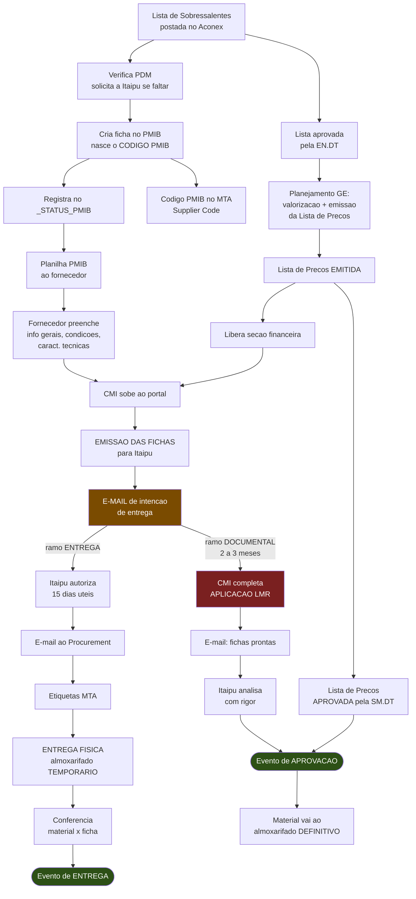

# Fluxo Macro de Entrega

> [!success] Versão validada
> Corrigido ponto a ponto pelo Luan em **31/08/2026**. Substitui a leitura anterior,
> feita só a partir dos slides da [[Anexo I - Classificacao de Materiais Sobressalentes|apresentação PMIB R5]], que continha três erros
> materiais (listados no fim da nota).

O processo tem **um início comum** e depois **dois ramos que correm em velocidades
diferentes**: **entrega física** e **documental**. Eles se reencontram só no fim, quando
o material passa do almoxarifado temporario ao definitivo.

---

## Fase 0 — Preparacao

1. **Lista de Sobressalentes postada no Aconex.** Marco zero: a partir dai a engenharia
   do CMI pode começar a criar as fichas técnicas.
2. **Verificação de PDM.** Para cada material, checar se existe
   [[PDM - Padrao de Descricao de Material|PDM]] adequado no catalogo (~1174). Se não
   existir, **solicitar a Itaipu que crie**.
3. **Criação da ficha no portal PMIB.** Só a criação já gera o **código PMIB** — a ficha
   não precisa estar preenchida.
4. **Registro no [[Planilha STATUS_PMIB|_STATUS_PMIB]]**, a lista de gerenciamento do CMI.
5. O código PMIB vai para o **MTA**, campo *Supplier Code*, no formato
   `/ CÓD. PMIB 4500063671.xxxx`.

> [!note] A criação da ficha não espera a aprovação da lista
> Basta a lista **postada** no Aconex. A aprovação EN.DT só entra mais adiante.

---

## Fase 1 — A aprovação EN.DT destrava duas coisas

6. **Lista de Sobressalentes aprovada pela EN.DT.**
7. Com ela aprovada, pede-se ao **time de Planejamento da GE**:
   - a **valorização** dos itens;
   - a **emissão da Lista de Preços** no Aconex.

> [!important] Emitida ≠ aprovada — e a distinção importa muito
> - **Lista de Preços EMITIDA** no Aconex → libera o preenchimento da **seção
>   financeira** das fichas e **permite seguir com toda a trilha de ENTREGA**.
> - **Lista de Preços APROVADA** pela SM.DT → só e necessária para liberar o
>   **Evento de Aprovação**, no fim do ramo documental.
>
> Ou seja: **a aprovação da lista SM.DT não condiciona o recebimento dos materiais.**
> Ver [[Lista de Precos]].

---

## Fase 2 — Preenchimento

8. Gera-se a **Planilha PMIB** (extrato do PDM em Excel) e envia-se ao **fornecedor**,
   que preenche informações gerais, condições (armazenamento, transporte, manutenção,
   descarte) e características técnicas, devolvendo com datasheets, catalogos e fotos.
9. O CMI sobe esse conteudo ao portal — a mao ou pelo [[SIG-FT - Visao Geral|SIG-FT]].
10. O CMI preenche o que e dele: **[[Secao - Valorizacao|valorização]]** (Planejamento da
    GE) e **[[Secao - Aplicacao LMR|Aplicação LMR]]** (engenharia, a partir dos desenhos).
11. **Emissão das fichas para Itaipu.**

---

## Fase 3 — O ramo da ENTREGA FÍSICA

12. **E-mail de intenção de entrega** a Itaipu.

> [!important] Emissão das fichas e e-mail de intenção são **dois atos distintos**
> O e-mail de intenção **só vai depois** da emissão das fichas, e **os dois precisam
> existir**.
>
> ⏱️ **E deste e-mail que parte o relogio dos 2 a 3 meses do CMI** para a Aplicação LMR.

13. **Itaipu tem 15 dias úteis** para autorizar a entrega, se estiver tudo certo.
14. **E-mail ao Procurement responsável** comunicando que o sobressalente foi autorizado
    por IB para entrega.
15. **Entrega física no almoxarifado de Itaipu** — nunca passando pelo almoxarifado do CMI.

> [!warning] As 3 condicionais da entrega física
> A entrega só deve ocorrer se as três estiverem cumpridas:
> 1. **Etiquetas do MTA** impressas e coladas;
> 2. **E-mail de autorização** de Itaipu recebido;
> 3. **Lista EN.DT aprovada**.
>
> A **lista de preços aprovada não está entre elas** — basta estar emitida.

16. Como a ficha ainda não está aprovada, o material fica no
    **[[MTA, Etiquetas e Entrega no Almoxarifado|almoxarifado temporario]]** de Itaipu.
17. **Conferencia dos materiais contra as fichas.** Constatado que esta tudo certo, e só
    entao, **libera-se o Evento de Entrega dos Sobressalentes**.

> [!note] O Evento de Entrega não dispara na autorização
> Dispara **depois da entrega física**, na conferencia material-x-ficha.

---

## Fase 4 — O ramo DOCUMENTAL

18. Dentro de **2 a 3 meses contados do e-mail de intenção (passo 12)**, o CMI:
    - completa a **Aplicação LMR** de todos os itens;
    - envia a Itaipu o **e-mail comunicando que está pronta**.
19. **Só entao Itaipu analisa as fichas com rigor.**
20. Fichas aprovadas → **libera-se o Evento de Aprovação dos Sobressalentes**.

> [!important] O Evento de Aprovação exige a lista de preços **aprovada**
> Único ponto do fluxo onde a aprovação SM.DT e condicionante.

21. O material passa do almoxarifado **temporario** ao **definitivo**.

---

## Diagrama

---

## Os prazos

| Etapa | Prazo | De quem e o relogio |
|---|---|---|
| Itaipu autorizar a entrega | **15 dias úteis** após o e-mail de intenção | Itaipu |
| **CMI subir a Aplicação LMR e reenviar** | **2 a 3 meses** após o e-mail de intenção | **CMI** |
| Análise e aprovação das fichas | sem prazo fixo — começa só após o e-mail de LMR pronta | Itaipu |

> [!danger] O compromisso dos 2/3 meses ainda está em aprovação
> está sendo formalizado, mas a formalizacao **depende da entrega do plano de ação** do
> CMI. Ver [[Plano de Acao - Aplicacao LMR]].
>
> Quantos itens já estouraram esse prazo se calcula a partir da coluna
> `DATA DO EMAIL COMUNICANDO ENTREGA` — ver [[Plano - Dimensao de Tempo]].

---

## A brecha e o pedido de alteração de fluxo

> [!warning] O que aconteceu
> O CMI **emitiu fichas para análise sem a seção de Aplicação LMR preenchida** — o portal
> e Itaipu aceitavam. **Itaipu passou a bloquear o recebimento** enquanto a LMR não
> estiver preenchida.
>
> Por isso o CMI **pediu alteração do fluxo**: que a Aplicação LMR deixe de ser condição
> para **entregar**, permanecendo condição para **aprovar**. A contrapartida prometida e
> o [[Plano de Acao - Aplicacao LMR|plano de ação]].

---

## Correções feitas em 31/08/2026

| Erro da leitura anterior | Correção |
|---|---|
| "Itaipu verifica as fichas — 2 a 3 meses" | Os 2/3 meses são **compromisso do CMI** para subir a LMR, contados do e-mail de intenção |
| "Emitir ficha = e-mail de intenção" | São **dois atos distintos**; a intenção vem **depois** da emissão |
| "Evento de Entrega dispara na autorização" | Dispara na **conferencia material-x-ficha**, após a entrega física |
| (ausente) | Lista de preços **emitida** basta para entregar; **aprovada** só para o Evento de Aprovação |

## Relacionados
[[Lista de Precos]] · [[Planilha STATUS_PMIB]] · [[Secao - Aplicacao LMR]] ·
[[Entrega Documental e Explosao de Itens]] · [[MTA, Etiquetas e Entrega no Almoxarifado]] ·
[[Ata AR-EN.DT-001-2026 - As Duas Listas]] · [[Plano de Acao - Aplicacao LMR]]
