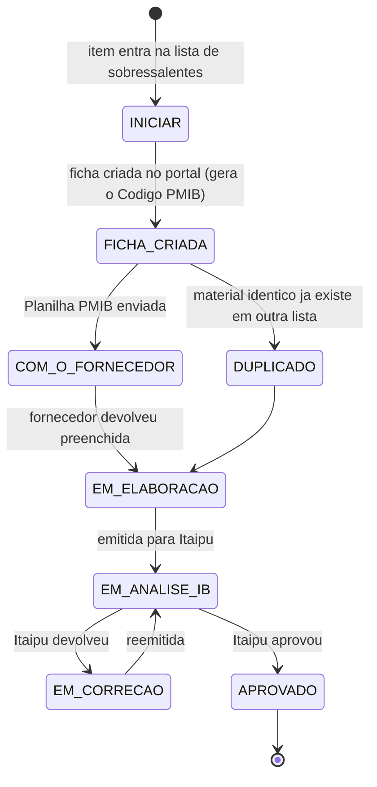

# Ciclo de Vida de um Item

A vida de **um material** sobressalente, do projeto até a aprovação. Esta e a nota que
amarra tudo: cada estagio aponta para a nota que o detalha.

## O caminho



## Estagio por estagio

### 1. `INICIAR`
O item existe na [[Lista de Sobressalentes]], nada foi feito.
**Gatilho para sair**: escolher o [[PDM - Padrao de Descricao de Material|PDM]] e criar
a ficha.

### 2. `FICHA CRIADA`
A ficha existe no portal, vazia. **O [[Codigo PMIB]] já nasceu** — e já pode ir para o
MTA. Ver [[MTA, Etiquetas e Entrega no Almoxarifado]].
Nesse ponto se escreve `CODIGO PMIB` e `PDM usado` no [[Planilha STATUS_PMIB]].

### 3. `COM O FORNECEDOR`
A [[Planilha PMIB]] foi enviada. O fornecedor preenche
[[Secao - Informacoes Gerais|informações gerais]], [[Secao - Condicoes|condições]] e
[[Secao - Caracteristicas Tecnicas|características técnicas]], e fornece datasheets,
catalogos e fotos.

### 4. `EM ELABORACAO`
O CMI transfere o conteudo para o portal e completa o que e dele:
- **[[Secao - Valorizacao]]** — depende da lista EN.DT aprovada e da [[Lista de Precos]]
- **[[Secao - Aplicacao LMR]]** — depende dos desenhos e do mapeamento de documentos
- **[[Secao - Documentos e Imagens]]** — upload

> [!warning] O estrangulamento está aqui
> Este e o estagio onde o item pode ficar preso por dois motivos que **não dependem do
> fornecedor**: valorização travada em lista não aprovada, e LMR pendente de desenho.
> Ver [[Diagnostico - Deficiencias]].

### 5. `EM ANALISE IB`
Ficha emitida para Itaipu. **2 a 3 meses** de verificação.
Em paralelo corre a trilha de entrega física: e-mail de intenção -> autorização
(15 d.u.) -> etiquetas MTA -> entrega no almoxarifado.

### 6. `EM CORRECAO`
Itaipu devolveu com comentários. Volta para elaboração e reemite.

### 7. `APROVADO`
Fecha o **Evento de Aprovação dos Sobressalentes**.

### Desvio: `DUPLICADO`
Se na criação o portal recusa a referência por já existir, o item vira
[[Fichas Duplicadas|ficha duplicada]] com `PDM.9900.000`.

## Os dois relogios que correm juntos

```
TRILHA DOCUMENTAL:  criar ficha -> preencher -> emitir -> analise (2-3 meses) -> APROVADO
                                                              ↓
                                                    Evento de APROVACAO

TRILHA LOGISTICA:   codigo PMIB -> MTA -> intencao -> autorizacao (15 d.u.) -> etiqueta -> entrega
                                                              ↓
                                                    Evento de ENTREGA
```

Confundir os dois eventos e erro comum. **Entregar o material não aprova a ficha.**

## Onde cada estagio e registrado

| Estagio | `_STATUS_PMIB` coluna `STATUS` | Mapeadora |
|---|---|---|
| INICIAR | `INICIAR` | `SITUACAO NO PMIB = INICIAR` |
| FICHA CRIADA | `FICHA CRIADA` | `FICHAS EXISTENTES` |
| COM O FORNECEDOR | `COM O FORNECEDOR` | `FICHAS COM O FORNECEDOR` |
| EM ELABORAÇÃO | `EM ELABORACAO` | `FICHAS EM ELABORACAO` |
| EM ANÁLISE IB | `EM ANALISE IB` | `FICHAS EM ANALISE DE ITAIPU` |
| EM CORREÇÃO | `EM CORRECAO` | `FICHAS EM CORRECAO` |
| APROVADO | `APROVADO` | `FICHAS APROVADAS` |

## Relacionados
[[Fluxo Macro de Entrega]] · [[Planilha STATUS_PMIB]] · [[Indicadores e Como Ler]]
