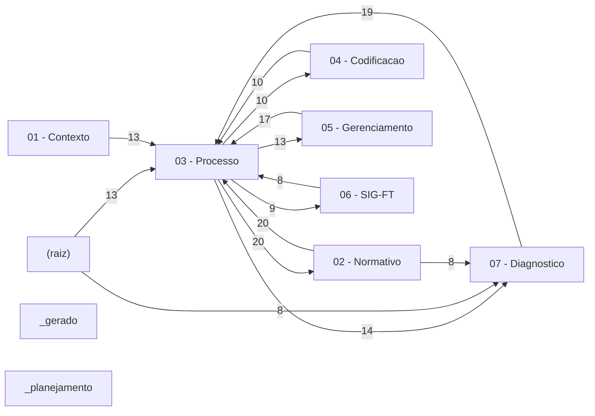

# Mapa de Conexoes

> [!warning] Documento de trabalho, nao conhecimento permanente
> Contem numeros e situacoes de uma data especifica. O que descreve **como o processo
> funciona** mora no nucleo do cofre (`01` a `06`).

> [!warning] Nota gerada automaticamente
> Rode `python _scripts/mapa_de_conexoes.py` para regenerar.

**56 notas**, **447 ligacoes** entre elas.

## Os nos centrais

As notas com mais ligacoes. Se uma delas estiver errada, o erro se espalha —
sao as que merecem revisao mais cuidadosa.

| # | Nota | Secao | Aponta para | Apontada por | Grau |
|---:|---|---|---:|---:|---:|
| 1 | [[00 - Inicio]] | (raiz) | 54 | 2 | **56** |
| 2 | [[SIG-FT - Modulos]] | 06 - SIG-FT | 15 | 23 | **38** |
| 3 | [[Secao - Aplicacao LMR]] | 03 - Processo | 8 | 26 | **34** |
| 4 | [[Diagnostico - Deficiencias]] | 07 - Diagnostico | 12 | 22 | **34** |
| 5 | [[Planilha STATUS_PMIB]] | 05 - Gerenciamento | 6 | 25 | **31** |
| 6 | [[Anatomia de uma Ficha Tecnica]] | 03 - Processo | 13 | 12 | **25** |
| 7 | [[Anexo I - Classificacao de Materiais Sobressalentes]] | 02 - Normativo | 9 | 15 | **24** |
| 8 | [[Lista de Precos]] | 03 - Processo | 7 | 17 | **24** |
| 9 | [[Secao - Valorizacao]] | 03 - Processo | 8 | 15 | **23** |
| 10 | [[PDM - Padrao de Descricao de Material]] | 04 - Codificacao | 10 | 13 | **23** |
| 11 | [[Mapeamento das Listas de Sobressalentes]] | 05 - Gerenciamento | 8 | 15 | **23** |
| 12 | [[Fluxo Macro de Entrega]] | 03 - Processo | 12 | 9 | **21** |
| 13 | [[Ciclo de Vida de um Item]] | 05 - Gerenciamento | 17 | 4 | **21** |
| 14 | [[Diagnostico - Riscos]] | 07 - Diagnostico | 7 | 14 | **21** |
| 15 | [[Capitulo 18 - Pecas de Reposicao e Sobressalentes]] | 02 - Normativo | 9 | 10 | **19** |

## Como as secoes conversam

| De | Para | Ligacoes |
|---|---|---:|
| 02 - Normativo | 03 - Processo | 20 |
| 03 - Processo | 02 - Normativo | 20 |
| 07 - Diagnostico | 03 - Processo | 19 |
| 05 - Gerenciamento | 03 - Processo | 17 |
| 03 - Processo | 07 - Diagnostico | 14 |
| (raiz) | 03 - Processo | 13 |
| 01 - Contexto | 03 - Processo | 13 |
| 03 - Processo | 05 - Gerenciamento | 13 |
| 03 - Processo | 04 - Codificacao | 10 |
| 04 - Codificacao | 03 - Processo | 10 |
| 03 - Processo | 06 - SIG-FT | 9 |
| (raiz) | 07 - Diagnostico | 8 |
| 02 - Normativo | 07 - Diagnostico | 8 |
| 06 - SIG-FT | 03 - Processo | 8 |
| 07 - Diagnostico | 05 - Gerenciamento | 8 |
| _gerado | 03 - Processo | 8 |
| (raiz) | 02 - Normativo | 7 |
| (raiz) | 06 - SIG-FT | 7 |

## Grafo das secoes

---

Voltar para [[00 - Inicio]]